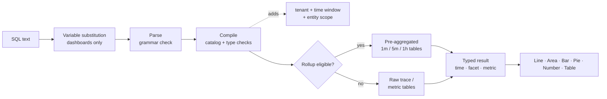

## SQL을 사용하여 쿼리하는 방법: 쿼리 기법 {#how-to-query-with-sql-the-mechanics-of-querying}

도구를 사용하기 전에 사용 방법을 아는 것이 도움이 됩니다. 이 문서는 데이터를 탐색하는 방법을 보여 주고, 쿼리가 실행될 때 발생하는 상황을 설명하고, 간단한 쿼리부터 복잡한 쿼리까지 예제 쿼리를 살펴봅니다.

### 데이터 탐색

SQL을 사용하는 가장 좋은 방법은 **Explore**&#x200B;을(를) 열고 직접 데이터를 테스트하는 것입니다.

> **팁**
>
> SQL은 읽기 전용입니다. 데이터를 변경하거나 삭제할 수 없으며 모든 쿼리의 범위가 테넌트로 지정됩니다.

1. 앱 상단의 테넌트 전환기에서 **고객 선택**. SQL에는 단일 테넌트가 필요합니다.
2. **탐색**&#x200B;을 엽니다. **Visual Builder** 탭에서는 **시작**(엔터티), **집계**, **필터**, **패싯** 및 **시계열**&#x200B;을 선택할 수 있습니다. 생성된 SQL이 아래에 나타납니다.
3. 쿼리를 직접 편집하려면 **SQL** 탭으로 전환하십시오. 사용자가 입력할 때 편집기는 엔티티, 속성 및 기능을 자동으로 완성합니다.
4. 오른쪽의 **쿼리 가이드** 패널을 열어 엔터티, 특성 유형 및 예제 쿼리를 찾아보십시오. 예를 클릭하여 로드합니다.
5. 쿼리를 실행하지 않고 확인하려면 **유효성 검사**&#x200B;를 클릭하고 결과를 보려면 **실행**(⌘/Ctrl + Enter)을 클릭하십시오.

`FROM`을(를) 입력하고 엔터티를 선택한 다음 `SELECT` 및 특성을 추가합니다.

```sql
FROM Transaction SELECT name, duration LIMIT 20
```

기본 **이벤트 쿼리**&#x200B;입니다. 20개의 인바운드 요청을 반환하며 각 요청의 작업 이름과 기간을 표시합니다.

이제 특성을 **집계**(으)로 바꾸고 결과를 그룹화합니다.

```sql
FROM Transaction SELECT count(*) FACET service
```

이렇게 하면 보고 중인 서비스를 보여 주는 서비스당 요청이 계산됩니다.

> **중요**
>
> 빌드하기 전에 **검색.** 속성 가용성은 각 서비스가 계측되는 방식에 따라 다릅니다. 새 테넌트에서 [검색 쿼리](../../examples/query-cookbook.md#data-discovery)를 먼저 실행하여 실제로 데이터를 포함하는 서비스, 호스트, 특성 및 지표를 확인합니다.

### 쿼리 실행 방법

쿼리를 실행할 때 Observability Insights:

1. **변수 대체**, `{{name}}`개 토큰을 현재 대시보드 변수 선택 항목으로 바꾸기. 이 작업은 브라우저에서 대시보드에서만 수행됩니다.
2. 텍스트를 **구문 분석**&#x200B;합니다. 세미콜론, 원시 SQL 함수 및 하위 쿼리를 포함하여 SQL 문법 외부의 모든 항목은 거부됩니다.
3. 쿼리를 **컴파일**&#x200B;합니다. 각 논리 특성(예: `urlPath`)을 저장된 식에 매핑하고 형식 및 함수를 확인합니다.
4. **필수 가드를 추가합니다**: 테넌트, 기간 및 엔터티의 고정 범위(예: `Transaction`은(는) 서버 범위만 의미).
5. **적격 시계열 쿼리를 사전 집계된**&#x200B;롤업&#x200B;**테이블에 보냅니다.** 이 값은 자동이며 결과는 원시 데이터와 일치합니다.
6. **15초 시간 제한 및 바이트 읽기 예산으로 쿼리를 실행한 다음 UI가 렌더링하는 형식화된 열(시간, 패싯, 지표)을 반환합니다**.



### 결과 셰이프

모든 쿼리는 네 가지 모양 중 하나를 반환합니다. 모양이 어떤 차트가 적절한지 결정합니다.

| 모양 | 얻는 방법 | 기본 `LIMIT` | 최상의 시각화 |
| --------------- | ---------------------------------------------------- | --------------- | ------------------ |
| **게시판** | `FACET` 및 `TIMESERIES` 없이 집계만 가능 | 1 | 숫자 |
| **Facet** | 집계 + `FACET` | 10 | 막대, 파이, 테이블 |
| **시계열** | 집계 + `TIMESERIES`(`FACET` 포함 또는 제외) | 5,000행 | 선, 영역, 막대 |
| **이벤트** | 원시 속성만 | 100 | 테이블 |

<a id="time-window-precedence"></a>

### 기간 우선 순위

| 쿼리가 실행되는 위치 | 어떤 창이 적용됩니까 |
| --------------------------------- | ---------------------------------------------------------------------------------- |
| **대시보드 위젯** | 대시보드 **시간 선택기**. 쿼리의 `SINCE`/`UNTIL`이(가) 무시됩니다. |
| **위젯 미리 보기 추가** | **위젯 추가** 대화 상자의 시간 선택기입니다. |
| **탐색** | 전역 시간 선택기입니다. 선택기 범위가 활성 상태일 때는 `SINCE`/`UNTIL`이(가) 무시됩니다. |
| 명시적 범위가 없는 **API** | 쿼리에서 `SINCE`/`UNTIL`이(가) 마지막 시간으로 기본 설정됩니다. |

> **참고**
>
> 선택기가 대시보드 및 탐색에서 이기므로 이 안내서는 일반적으로 `SINCE`개의 대시보드 쿼리를 벗어납니다. 쿼리의 시간 선택기를 항상 정의해야 합니다.
