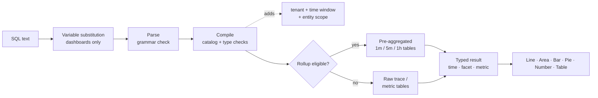

<a id="top"></a>

# Adobe Observability Insights 대시보드/쿼리 설명서

**Adobe Observability Insights 쿼리 언어(SQL)** - Adobe Observability Insights에서 원격 분석을 쿼리하고, 차트로 지정하고, 대시보드로 표시합니다.

|                |                                                                  |
| -------------- | ---------------------------------------------------------------- |
| **적용 대상** | Insights UI → **탐색** 및 **대시보드**(사용자 지정 대시보드) |
| **대상자** | SQL을 아는 엔지니어, SRE 및 고급 사용자 |

>[!TIP]
> `sql`(으)로 표시된 모든 코드 블록은 **SQL 탐색** 또는 **SQL→ 위젯 추가**→ 붙여 넣을 수 → SQL 쿼리입니다.

## 설명서 맵

| 섹션 | 문서 | 학습 내용 |
| --------------- | ----------------------------------------------------------------------------------- | ------------------------------------------------------------------------------------------- |
| **시작** | [1. SQL](#1-get-started-with-SQL-the-language-of-your-telemetry) 시작 | SQL 정의, 쿼리할 수 있는 내용, 사용할 위치, 기본 규칙 |
|                 | [2. SQL](#2-how-to-query-with-SQL-the-mechanics-of-querying)을(를) 사용하여 쿼리하는 방법 | 데이터 탐색 방법, 쿼리 실행 방법, 작동 예제 |
|                 | [3. 차트 및 대시보드](#3-charts-and-dashboards-visualizing-your-data) | 쿼리를 차트로 전환하고 단계별 대시보드를 작성하는 방법 |
| **참조** | [4. SQL 참조](#4-SQL-reference) | 모든 절, 함수 및 연산자(예 포함) |
|                 | [5. 데이터 사전](#5-data-dictionary) | 쿼리할 수 있는 모든 엔티티 및 속성 |
| **튜토리얼** | [6. 자습서 1: 첫 번째 쿼리](#6-tutorial-1-your-first-queries) | `SELECT`, `FROM`, `LIMIT`, 집계, 시간, `TIMESERIES`, `WHERE`, `FACET` |
|                 | [7. 자습서 2: 데이터 제어](#7-tutorial-2-control-your-data) | 고유 값, 최근/가장 이른 값, 백분율, 백분위수, 레이블, 와일드카드, 순서 지정 |
|                 | [8. 자습서 3: 대시보드를 진행합니다](#8-tutorial-3-advance-your-dashboarding) | 조건부 합계, Apdex, 환율, 히스토그램, 공식, 변수, 섹션 |
|                 | [9. 자습서 4: 고급 함수](#9-tutorial-4-advanced-functions) | `stddev`, `derivative`, `latest` 등급, 총 점유율, 범위 구성, 지표 검색 |
| **예** | [10. 쿼리 Cookbook](#10-query-cookbook) | 주제별 100개 이상의 즉시 사용 가능한 쿼리(AEM 포함) |
|                 | [11. 대시보드 블루프린트](#11-dashboard-blueprints) | 모든 위젯의 쿼리가 포함된 10개의 완전하고 복잡한 대시보드 |
| **운영** | [12. 성능](#12-performance) | 롤업, 쿼리 예산 및 대시보드를 빠르게 유지하는 방법 |
|                 | [13. 문제 해결](#13-troubleshooting) | 모든 오류 메시지, 의미 및 수정 방법 |
|                 | [14. 부록](#14-appendix) | 제한, 내보내기 파일 형식, 한 페이지 치트 시트 |

&#x200B;# 시작하기

## &#x200B;1. SQL 시작하기: 원격 분석 언어

SQL은 Observability Insights 데이터의 SQL과 유사한 쿼리 언어입니다. 모든 사용자 지정 대시보드 위젯 및 **탐색** 페이지의 언어와 동일하기 때문에 팀에 필요한 보기를 빌드할 수 있습니다.

SQL은 `Transaction`, `Span` 또는 `CpuUtilization`과(와) 같은 친숙한 논리 보기인 **entities**&#x200B;에서 작동합니다. 저장소 테이블을 직접 쿼리하지 않습니다. Observability Insights는 각 SQL 쿼리를 안전하고 매개 변수가 지정된 웨어하우스 쿼리로 컴파일합니다. 항상 테넌트 및 선택한 시간 창에 쿼리하는 범위를 지정합니다.

```sql
SELECT count(*) AS requests FROM Transaction TIMESERIES AUTO
```

### SQL로 수행할 수 있는 작업

SQL을 사용하여 다음을 수행합니다.

- 시간 경과에 따른 처리량, 오류율, 지연, Apdex, CPU, 메모리, JVM 힙, 디스크 및 네트워크의 **차트 빌드**.
- **게시 계층의 어떤 URL 경로에 가장 낮은 p95가 있습니까?&quot;와 같은 특정 질문에 답변** 또는 &quot;어느 다운스트림 도메인이 실패합니까?&quot;
- KPI에서 개별 요청 및 추적 ID로 드릴다운하여 **인시던트를 조사합니다**.
- KPI, 트렌드, 테이블, 수식, 메모, 섹션 머리글 및 변수를 사용하여 **대시보드를 빌드**&#x200B;합니다.
- Sling, JSP, JCR, Dispatcher 및 GraphQL 특성을 사용하여 **AEM 워크로드 프로필**(Adobe Experience Manager).

SQL은 개별 요청 행을 반환하는 **이벤트 쿼리**&#x200B;와 합계, 백분위수, 비율, 분류 및 시계열을 반환하는 **집계 쿼리**&#x200B;를 모두 지원합니다.

>[!TIP]
> **대시보드 → 만들기**&#x200B;의 템플릿은 완전히 SQL에서 빌드되었습니다. 연필 아이콘이 있는 템플릿 위젯을 열어 쿼리를 보고 학습합니다.

### 쿼리할 수 있는 사항

SQL은 4개의 데이터 제품군을 쿼리할 수 있습니다. 전체 목록이 [데이터 사전](#5-data-dictionary)에 있습니다.

| 패밀리 | 엔티티 | 일반적인 질문 |
| ------------------------------------ | ------------------------------------------------------------------------------------------------------------------------------------------------------------------ | -------------------------------------------------------------------- |
| **추적(APM)** | `Transaction`(인바운드 요청), `AppRequest`(요청 + 메시지 소비자), `Span`(모든 범위) | 처리량, 지연, 오류, Apdex, 다운스트림 호출, AEM 코드 경로 |
| **조정된 호스트 및 런타임 지표** | `CpuUtilization`, `MemoryUtilization`, `LoadAverage5m`, `DiskUtilization`, `NetworkReceiveRate`, `JvmHeapUsed`, `JvmThreadCount`, `DispatcherRequestRate` 이상 | 포화, 용량, JVM 상태, 디스패처 로드 |
| **일반 지표** | `MetricGauge`, `MetricSum` | 이름별 모든 OpenTelemetry 지표, 지표 검색 |
| **미리 집계된 범위 컴포지션** | `SpanBreakdown` | 트랜잭션을 구성하는 하위 작업 |

>[!NOTE]
> 로그, 경고 정의 및 인벤토리 관계를 사용할 수 없습니다.

### SQL 사용 위치

| 위치 | 여는 방법 | 무엇을 위한 것입니까 |
| ----------------------- | ------------------------------------------------------------------------------ | ------------------------------------------------------------------------------------------------------------------------------------------------------------------------------------ |
| **탐색** | 왼쪽 탐색 → **탐색** | Ad hoc analysis. **Visual Builder** 또는 **SQL** 탭, **유효성 검사**&#x200B;를 사용한 다음 **실행**(⌘/Ctrl + Enter)을 사용하십시오. **기록** 및 **저장됨** 쿼리와 **쿼리 안내서** 패널을 포함합니다. |
| **대시보드** | 왼쪽 탐색 → **대시보드**&#x200B;를 열거나 대시보드를 만들 → 있습니다. →2&rbrace;위젯 추가&#x200B;**&#x200B;** | 지속적인 차트, KPI 및 테이블을 대시보드로 결합. |
| **공식 위젯** | **공식→ 위젯 추가** | 2-6개의 SQL 쿼리를 산술(비율, 여유 공간, 굽기 비율)과 결합합니다. |
| **대시보드 변수** | 쿼리에서 **+ 변수 →** | SQL `FACET` 쿼리의 개별 값에서 선택기를 채웁니다. |
| **쿼리 검사** | 차트 가리키기 → 쿼리 검사 | 기본 제공 또는 대시보드 차트 뒤에 있는 SQL을 확인합니다. |

### SQL 쿼리 구조

SQL은 절 기반 구문을 따릅니다. 이 쿼리는 선택한 창의 모든 인바운드 요청을 계산합니다.

```sql
SELECT count(*) FROM Transaction
```

사용 가능한 모든 조항은 다음과 같습니다.

```text
SELECT  function(attribute) [FILTER (WHERE condition)] [AS alias] [, ...]
        | attribute [AS alias] [, ...]
FROM    Entity
  [WHERE      condition [AND | OR ...]]
  [FACET      attribute [, attribute ...]]        -- up to 5
  [SINCE      n unit [AGO]]
  [UNTIL      NOW | n unit [AGO]]
  [TIMESERIES AUTO | MAX | n unit]
  [ORDER BY   alias [ASC | DESC]]
  [LIMIT      number]                              -- 1 to 5000
```

다음은 SQL이 따르는 규칙입니다.

| 규칙 | 세부 사항 |
| ---------------------------- | ------------------------------------------------------------------------------------------------------------------------------------------------------------------------------------ |
| **필수 절** | `SELECT` 및 `FROM`은(는) 필수입니다. 다른 모든 조항은 선택 사항입니다. 다음 중 하나로 시작할 수 있습니다. `FROM Transaction SELECT count(*)`도 유효합니다. |
| **절 순서** | `FROM` 이후의 절은 모든 순서로 나타날 수 있습니다. 각 절은 한 번만 나타날 수 있습니다. |
| **쿼리 크기** | 쿼리는 4KB 이하여야 합니다. |
| **대/소문자 구분** | 키워드, 함수 이름, 엔터티 이름 및 특성 이름은 **대/소문자를 구분하지 않습니다**. 문자열 값 **은(는) 대/소문자를 구분합니다(`'Error'` ≠ `'error'`).** |
| **문자열** | 작은 따옴표 사용: `WHERE status = 'Error'`. 견적을 포함하려면 `'O''Brien'`을(를) 두 배로 늘립니다. 큰따옴표는 허용되지 않습니다. |
| **리터럴** | 문자열, 숫자(음수 및 십진수 포함), `TRUE`, `FALSE`, `NULL`. |
| **특성 이름** | 이름에는 문자, 숫자, `_` 및 `.`(예: `http.statusCode`)이 포함될 수 있습니다. 백틱이 필요하지 않습니다. |
| **집계와 특성 비교** | 쿼리는 원시 속성(이벤트 목록) 또는 합계를 선택합니다. 둘 다 선택할 수는 없습니다. 그룹화하려면 `FACET`을(를) 사용합니다. |
| **기간** | 기본값은 마지막 시간입니다. 최대 31일입니다. 대시보드와 탐색에서 **시간 선택기**&#x200B;가 창을 설정합니다([시간 창](#time-window-precedence) 참조). |
| **지원되지 않음** | 세미콜론, 주석, 하위 쿼리, 조인, `SELECT *`, `SELECT`, `HAVING`, `COMPARE WITH`의 특성 간 계산. 대안은 [SQL에서 수행할 수 없는 작업](#what-SQL-doesnt-do)을 참조하십시오. |

### 다음 단계

- [SQL로 쿼리하는 방법](#2-how-to-query-with-SQL-the-mechanics-of-querying): 데이터를 살펴보고 쿼리가 실행되는 방식을 이해합니다.
- [차트 및 대시보드](#3-charts-and-dashboards-visualizing-your-data): 결과를 시각화합니다.
- [자습서 1: 첫 번째 쿼리](#6-tutorial-1-your-first-queries): 실습 연습
- [SQL 참조](#4-SQL-reference): 전체 구문, 절 및 함수입니다.

[↑ 위로 돌아가기](#top)

## &#x200B;2. SQL을 사용하여 쿼리하는 방법: 쿼리 기법

도구를 사용하기 전에 사용 방법을 아는 것이 도움이 됩니다. 이 문서는 데이터를 탐색하는 방법을 보여 주고, 쿼리가 실행될 때 발생하는 상황을 설명하고, 간단한 쿼리부터 복잡한 쿼리까지 예제 쿼리를 살펴봅니다.

### 데이터 탐색

SQL을 사용하는 가장 좋은 방법은 **Explore**&#x200B;을(를) 열고 직접 데이터를 테스트하는 것입니다.

>[!TIP]
> SQL은 읽기 전용입니다. 데이터를 변경하거나 삭제할 수 없으며 모든 쿼리의 범위가 테넌트로 지정됩니다.

1. 앱 상단의 테넌트 전환기에서 **고객 선택**. SQL에는 단일 테넌트가 필요합니다.
2. **탐색**&#x200B;을 엽니다. **Visual Builder** 탭에서는 **시작**(엔터티), **집계**, **필터**, **패싯** 및 **시계열**&#x200B;을 선택할 수 있습니다. 생성된 SQL이 아래에 나타납니다.
3. 쿼리를 직접 편집하려면 **SQL** 탭으로 전환하십시오. 사용자가 입력할 때 편집기는 엔티티, 속성 및 기능을 자동으로 완성합니다.
4. 오른쪽의 **쿼리 가이드** 패널을 열어 엔터티, 특성 유형 및 예제 쿼리를 찾아보십시오. 예를 클릭하여 로드합니다.
5. 쿼리를 실행하지 않고 확인하려면 **유효성 검사**&#x200B;를 클릭하고 결과를 보려면 **실행**(⌘/Ctrl + Enter)을 클릭하십시오.

`FROM`을(를) 입력하고 엔터티를 선택한 다음 `SELECT` 및 특성을 추가합니다.

```sql
FROM Transaction SELECT name, duration LIMIT 20
```

기본 **이벤트 쿼리**&#x200B;입니다. 20개의 인바운드 요청을 반환하며 각 요청의 작업 이름과 기간을 표시합니다.

이제 특성을 **집계**(으)로 바꾸고 결과를 그룹화합니다.

```sql
FROM Transaction SELECT count(*) FACET service
```

이렇게 하면 보고 중인 서비스를 보여 주는 서비스당 요청이 계산됩니다.

>[!IMPORTANT]
> 빌드하기 전에 **검색.** 속성 가용성은 각 서비스가 계측되는 방식에 따라 다릅니다. 새 테넌트에서 [검색 쿼리](#101-data-discovery)를 먼저 실행하여 실제로 데이터를 포함하는 서비스, 호스트, 특성 및 지표를 확인합니다.

### 쿼리 실행 방법

쿼리를 실행할 때 Observability Insights:

1. **변수 대체**, `{{name}}`개 토큰을 현재 대시보드 변수 선택 항목으로 바꾸기. 이 작업은 브라우저에서 대시보드에서만 수행됩니다.
2. 텍스트를 **구문 분석**&#x200B;합니다. 세미콜론, 원시 SQL 함수 및 하위 쿼리를 포함하여 SQL 문법 외부의 모든 항목은 거부됩니다.
3. 쿼리를 **컴파일**&#x200B;합니다. 각 논리 특성(예: `urlPath`)을 저장된 식에 매핑하고 형식 및 함수를 확인합니다.
4. **필수 가드를 추가합니다**: 테넌트, 기간 및 엔터티의 고정 범위(예: `Transaction`은(는) 서버 범위만 의미).
5. **적격 시계열 쿼리를 사전 집계된**&#x200B;롤업&#x200B;**테이블에 보냅니다.** 이 값은 자동이며 결과는 원시 데이터와 일치합니다.
6. **15초 시간 제한 및 바이트 읽기 예산으로 쿼리를 실행한 다음 UI가 렌더링하는 형식화된 열(시간, 패싯, 지표)을 반환합니다**.



### 결과 셰이프

모든 쿼리는 네 가지 모양 중 하나를 반환합니다. 모양이 어떤 차트가 적절한지 결정합니다.

| 모양 | 얻는 방법 | 기본 `LIMIT` | 최상의 시각화 |
| --------------- | ---------------------------------------------------- | --------------- | ------------------ |
| **게시판** | `FACET` 및 `TIMESERIES` 없이 집계만 가능 | 1 | 숫자 |
| **Facet** | 집계 + `FACET` | 10 | 막대, 파이, 테이블 |
| **시계열** | 집계 + `TIMESERIES`(`FACET` 포함 또는 제외) | 5,000행 | 선, 영역, 막대 |
| **이벤트** | 원시 속성만 | 100 | 테이블 |

<a id="time-window-precedence"></a>

### 기간 우선 순위

| 쿼리가 실행되는 위치 | 어떤 창이 적용됩니까 |
| --------------------------------- | ---------------------------------------------------------------------------------- |
| **대시보드 위젯** | 대시보드 **시간 선택기**. 쿼리의 `SINCE`/`UNTIL`이(가) 무시됩니다. |
| **위젯 미리 보기 추가** | **위젯 추가** 대화 상자의 시간 선택기입니다. |
| **탐색** | 전역 시간 선택기입니다. 선택기 범위가 활성 상태일 때는 `SINCE`/`UNTIL`이(가) 무시됩니다. |
| 명시적 범위가 없는 **API** | 쿼리에서 `SINCE`/`UNTIL`이(가) 마지막 시간으로 기본 설정됩니다. |

>[!NOTE]
> 선택기가 대시보드 및 탐색에서 이기므로 이 안내서는 일반적으로 `SINCE`개의 대시보드 쿼리를 벗어납니다. 쿼리의 시간 선택기를 항상 정의해야 합니다.

### SQL 쿼리 예제

다음은 보다 완벽한 예입니다. 이 쿼리의 경우:

- `Transaction`을(를) 엔터티로 선택합니다.
- `SELECT`을(를) 사용하여 95번째 백분위수 기간을 계산합니다.
- `FACET`을(를) 사용하여 서비스별로 결과를 그룹화합니다.
- `TIMESERIES AUTO`을(를) 사용하여 자동으로 크기가 조정된 간격으로 데이터를 그립니다.

```sql
FROM Transaction SELECT percentile(duration, 95) AS p95 FACET service TIMESERIES AUTO
```

이렇게 하면 기본적으로 10개의 가장 바쁜 서비스가 표시된 라인 차트에서 서비스당 한 개의 라인이 생성됩니다.

아래의 각 예를 클릭하여 확장합니다.

<details>
<summary><strong>인바운드 요청의 기본 쿼리</strong></summary>

모든 인바운드 요청의 평균 응답 시간(밀리초):

```sql
SELECT average(duration) FROM Transaction
```

</details>

<details>
<summary><strong>점이 포함된 특성 이름</strong></summary>

점선 이름은 따옴표를 사용하지 않아도 됩니다.

```sql
SELECT count(*) FROM Transaction WHERE http.statusCode >= 500 FACET http.route
```

</details>

<details>
<summary><strong>여러 열을 반환하는 쿼리</strong></summary>

한 쿼리의 여러 합계가 테이블의 열이 됩니다.

```sql
SELECT count(*) AS requests, average(duration) AS avgMs, percentile(duration, 95) AS p95, max(duration) AS maxMs FROM Transaction FACET service
```

</details>

<details>
<summary><strong>한 번의 패스로 조건부 집계</strong></summary>

합계, 오류 및 5xx 나란히:

```sql
SELECT count(*) AS total, count(*) FILTER (WHERE status = 'Error') AS errors, count(*) FILTER (WHERE http.statusCode >= 500) AS http5xx FROM Transaction FACET service
```

</details>

<details>
<summary><strong>큐레이션된 지표 쿼리</strong></summary>

시간 경과에 따른 호스트당 평균 CPU:

```sql
SELECT average(value) AS cpu FROM CpuUtilization FACET host TIMESERIES AUTO
```

</details>

<details>
<summary><strong>이름별로 OpenTelemetry 지표를 쿼리하는 중</strong></summary>

조정된 엔터티가 없는 지표에 `MetricGauge` / `MetricSum` 사용:

```sql
SELECT latest(value) AS bytesUsed FROM MetricSum WHERE metric = 'jvm.memory.used' FACET host, pool
```

</details>

<a id="what-SQL-doesnt-do"></a>

### SQL에서 수행할 수 없는 작업

SQL은 의도적으로 작습니다. 이렇게 하면 쿼리가 안전하고 신속하며 테넌트가 격리됩니다. 이러한 기능 중 하나가 필요한 경우 대체 기능을 사용하십시오.

| 기능 | 상태 | 대체 |
| ------------------------------------------- | ------------- | ------------------------------------------------------------------------------------------------------------ |
| `SELECT *` | 지원되지 않음 | 원하는 특성을 나열합니다. `SELECT timestamp, name, duration, traceId …` |
| 원시 속성 및 집계 혼합 | 지원되지 않음 | `FACET attr` 또는 `latest(attr)` / `earliest(attr)`을(를) 사용합니다. |
| `SELECT`의 계산(`a - b`, `count(*) / 60`) | 지원되지 않음 | **수식** 위젯(대시보드). |
| 조인 및 하위 쿼리 | 지원되지 않음 | **수식** 위젯 또는 두 개의 위젯이 나란히 표시됩니다. |
| `HAVING` | 지원되지 않음 | `ORDER BY alias` + `LIMIT`. |
| `COMPARE WITH` | 지원되지 않음 | 시간 선택기를 변경하거나 두 개의 위젯을 다른 탭에 배치합니다. |
| `FACET CASES` | 지원되지 않음 | 케이스당 하나의 `count(*) FILTER (WHERE …)` 열([자습서 3](#83-group-values-into-cases-with-filter) 참조). |
| `histogram()` | 지원되지 않음 | `FILTER`개 열이 그룹화되었습니다([자습서 3](#84-build-a-latency-histogram) 참조). |
| `uniques()` / `keyset()` | 지원되지 않음 | `FACET attr LIMIT n`은(는) 고유한 값을 나열합니다. 검색은 지표 및 채워진 속성을 나열합니다. |
| `RLIKE`(정규 표현식) | 지원되지 않음 | `%` 및 `_` 와일드카드가 있는 `LIKE` / `NOT LIKE` 또는 `IN (…)`입니다. |
| 댓글(`--`, `//`, `/* */`) | 지원되지 않음 | 위젯 제목 또는 **텍스트** 위젯에 메모를 넣습니다. |
| `SINCE`의 절대 날짜 | 지원되지 않음 | 시간 선택기의 절대 범위를 사용합니다. |
| 형식 전환(`numeric()`, `string()`) | 필요 없음 | 카탈로그에 특성이 입력됩니다. |

[↑ 위로 돌아가기](#top)

## &#x200B;3. 차트 및 대시보드: 데이터 시각화

쿼리는 필요한 정보를 찾습니다. 차트와 대시보드는 조직에 유용한 정보를 제공합니다. 이 문서는 SQL 결과가 차트가 되는 방법과 대시보드를 빌드, 구성 및 공유하는 방법을 보여 줍니다.

### 차트

모든 SQL 결과를 6개의 차트 유형 중 하나로 렌더링할 수 있습니다.

| 차트 유형 | 다음에 사용: | 쿼리 모양 |
| --------------- | --------------------------------------------------- | ----------------------------------------------- |
| **줄** | 시간 경과에 따른 트렌드, Facet 값당 한 줄 | 집계 + `TIMESERIES` |
| **영역** | 서비스별 처리량과 같이 시간에 따른 볼륨 | 집계 + `TIMESERIES` |
| **막대** | 범주 비교, 스파스 시계열 | 집계 + `FACET`(± `TIMESERIES`) |
| **원형/도넛** | 전체 공유(상태 코드 믹스, 계층별 트래픽) | 하나의 집계 + `FACET`, 적은 값 |
| **숫자** | 단일 KPI, 선택적 색상 임계값 | 게시판(집계만 해당) |
| **테이블** | 그룹 또는 이벤트 목록당 여러 집계 | 여러 집계 + `FACET` 또는 원시 특성 |

위젯이 대시보드에 있으면 다음을 수행할 수 있습니다.

- 쿼리, 제목, 차트 종류 및 단위(연필 아이콘)를 **편집**&#x200B;합니다.
- **복제**&#x200B;하여 다른 계층의 동일한 차트와 같은 변형을 만듭니다.
- 현재 행의 **CSV 다운로드** 또는 2× 해상도의 **PNG**.
- 손잡이 핸들을 **드래그**&#x200B;한 다음 오른쪽 아래에서 **크기 조정**&#x200B;합니다.

### 대시보드

차트는 자체적으로 잘 작동하지만 대시보드를 통해 하나로 통합됩니다. 대시보드는 **탭**&#x200B;의 명명된 테넌트 범위 컬렉션입니다. 각 탭은 **위젯**&#x200B;의 12열 그리드입니다.

| 개념 | 의미 |
| --------------- | ------------------------------------------------------------------------------------------------------------------------------- |
| **대시보드** | 선택한 테넌트에 대해 서버측에 저장된 1~40개 탭의 명명된 컬렉션입니다. |
| **탭** | 위젯 그리드 1개(최대 200개). 연필로 이름을 바꾸고, 연필로 ×, **+**&#x200B;이(가) 포함된 이름을 추가합니다. 하나 이상의 탭이 남아 있어야 합니다. |
| **위젯** | **단일 쿼리**, **수식** 또는 **텍스트**(메모 또는 축소 가능한 섹션 머리글). |
| **변수** | 그리드 위의 선택기입니다. 이 값은 `{{name}}`(으)로 삽입됩니다. |
| **시간 선택기** | 대시보드의 모든 위젯에 대한 창입니다. |

### 단계별 대시보드 만들기

#### 1단계: 시작하기 전에

- 테넌트 전환기에서 **단일 고객을 선택합니다**. **모든 계정**&#x200B;을(를) 선택하는 동안 **대시보드 만들기**&#x200B;를 사용할 수 없습니다. 데모 테넌트에 대해서는 SQL을 실행할 수 없습니다.
- **역할.** 대시보드 액세스 권한이 있는 모든 사용자는 위젯을 추가, 편집 및 저장할 수 있습니다. **변수**&#x200B;을(를) 만들거나 편집하고 위젯의 쿼리를 검사하는 것은 **조직 관리자** 및 **슈퍼 관리자**&#x200B;로 제한됩니다.

#### 2단계: 대시보드 만들기

1. 왼쪽 탐색에서 **대시보드**&#x200B;를 엽니다.
2. **대시보드 만들기**&#x200B;를 클릭합니다.
3. 시작점 선택:

   | 옵션 | 받은 항목 |
   | ---------------------------- | -------------------------------------------------------------------------------------------------------- |
   | **사용자 지정 대시보드 빌드** | 탭 하나가 있는 빈 대시보드. |
   | **CPU 기본 사항** | CPU(사용자/시스템/iowait/도용), 처리량, 로드, APDEX 호스팅 및 처리 |
   | **올인원 개요** | KPI(볼륨, 오류 %, Apdex, p95), 오류/트래픽 파이, CPU/메모리 테이블, JVM 스레드, 느린 작업 |
   | **상위 트랜잭션** | Apdex, 작업별 p95, 호스트당 로드/CPU, 추적 ID가 있는 가장 느린 트랜잭션, HTTP 오류 분류. |

4. **이름**&#x200B;을(를) 입력하고 확인하십시오. 대시보드 캔버스가 열립니다.

#### 3단계: 캔버스 알아보기

| 영역 | 컨트롤 |
| ---------------------------- | --------------------------------------------------------------------------------------------------------- |
| **상단 표시줄** | **위젯 추가**, **가이드**(인앱 치트 시트), **가져오기**, **내보내기**, **저장**, 시간 선택 및 새로 고침 |
| **변수 표시줄** | 테넌트 배지, 변수당 하나의 선택기, **+ 변수**(관리자) |
| **탭 모음** | 탭 전환, 이름 변경(연필), 삭제(×), 추가(+) |
| **표** | 열 12개. 위젯을 그립으로 드래그하고 모서리에서 크기를 조정합니다(최소 2×2). |
| **위젯 헤더**(마우스 오버 시) | CSV 다운로드, PNG 다운로드, 편집, 복제, 제거, 드래그 핸들 |

>[!IMPORTANT]
> **저장하는 것은 명시적입니다.** 레이아웃 변경, 새 위젯, 탭 및 변수는 **저장**&#x200B;을 클릭할 때까지 브라우저에 유지됩니다. 단추에 _저장 중... 저장 →_ 또는 _저장 실패_&#x200B;가 표시됩니다([문제 해결](#13-troubleshooting) 참조).

#### 4단계: 위젯 추가

**위젯 추가**&#x200B;를 클릭합니다. 대화 상자에는 **단일 쿼리**, **수식** 및 **텍스트**&#x200B;의 세 가지 모드가 있습니다. 또한 자체 시간 선택기가 있으므로 모든 창에서 위젯을 미리 볼 수 있습니다.

**옵션 A: 빌더(코드 없음)**

1. _(선택 사항)_ **도우미로 시작**: 골든 시그널, APM, AEM, 트랜잭션, 추적 및 범위, 인프라, 게시자, JVM 및 런타임 및 데이터 검색으로 그룹화된 57개의 사전 설정 중 하나를 선택하십시오. 사전 설정은 제목, 쿼리, 차트 유형 및 단위를 채웁니다.
2. **표시**: `Count`, `Average`, `Percentile`(및 해당 수준), `Sum`, `Min`, `Max` 또는 `Unique count`을(를) 선택한 다음 특성을 선택합니다.
3. **from**: 엔터티를 선택합니다.
4. **필터**: `attribute operator value`의 행 추가(`=`, `!=`, `>`, `<`, `>=`, `<=`, `LIKE`). 모든 행은 `AND`과(와) 결합됩니다.
5. **그룹화 기준**: 패싯 특성을 하나 선택하고 **상위 N**&#x200B;을 선택하여 가장 바쁜 계열만 유지합니다.
6. **시간 초과**: `TIMESERIES`을(를) 켜며 **매 N분마다** 버킷 크기를 갖습니다.
7. 양식에서 생성된 SQL을 확인한 다음 **쿼리 실행**&#x200B;을 클릭합니다.

**옵션 B: SQL 편집기**

1. 토글을 **빌더**&#x200B;에서 **SQL**(으)로 전환합니다. 기존 위젯을 편집하면 항상 SQL에서 열립니다.
2. 쿼리를 입력하거나 붙여 넣습니다. 라이브 카탈로그에서 편집기가 자동으로 완료됩니다.
3. **쿼리 안내서** 패널을 사용하여 엔터티, 특성 및 예제를 찾아보십시오.
4. **쿼리 실행**&#x200B;을 클릭합니다. _`<Entity>`쿼리가 유효합니다_, 실시간 미리 보기 및 요약(`N rows · N time points · N groups`)이 표시됩니다. 시간이 세 개 미만이면 _스파스 계열_ 경고가 나타납니다.

>[!TIP]
> 빌더는 가장 일반적인 쿼리를 처리합니다. `apdex`, `percentage`, `rate`, `FILTER`, 다중 집계, `OR`, `IN`, 여러 패싯 또는 `ORDER BY`에 대해 SQL로 전환하십시오.

#### 5단계: 모양 구성

| 필드 | 메모 |
| --------------------- | ----------------------------------------------------------------------------------------------------------------------------------------------------------------------- |
| **제목** | 최대 200자. `{{variable}}`개의 토큰을 포함할 수 있습니다. |
| **차트 종류** | `Line`, `Area`, `Bar`, `Pie / Donut`, `Number`, `Table`. 차트 유형은 각 실행 후 사용자가 직접 선택할 때까지 권장됩니다. |
| **단위** | 선택 사항입니다. 최대 40자(`ms`, `%`, `req/s`, `MB`, `bytes`)입니다. 유추한 단위를 사용하려면 비워 둡니다(예: `duration`의 경우 `ms`, `CpuUtilization`의 경우 `%`). |
| **색상 임계값** | 숫자 위젯만. _at 또는 `value` 이상 형식의 최대 10개 밴드→ 녹색/주황색/빨간색_&#x200B;입니다. 일치하는 가장 높은 밴드가 승리합니다. |

#### 6단계: 위젯 저장 후 대시보드 저장

**위젯 저장**&#x200B;은(는) 실행에서 데이터를 반환하는 후에만 활성화됩니다. 새 위젯은 6열 × 3행이며 행당 2개씩 압축됩니다. 정렬한 다음 상단 막대에서 **저장**&#x200B;을 클릭합니다.

### 오른쪽 차트 선택

| 쿼리 모양 | 최상의 차트 | 이유 |
| ------------------------------------------------- | ------------------- | ---------------------------------------------- |
| 집계 1개, `FACET` 없음, `TIMESERIES` 없음 | **숫자** | 단일 KPI 타일. 임계값을 추가합니다. |
| 집계 + `TIMESERIES` | **줄** / **영역** | 트렌드, Facet 값당 하나의 시리즈입니다. |
| 집계 + `FACET`(일부 값) | **막대** / **원형** | 범주를 비교합니다. 전체의 몫에 대한 파이입니다. |
| 여러 집계 + `FACET` | **테이블** | 각 합계는 열이 됩니다. |
| 원시 속성 | **테이블** | 이벤트 목록. |
| 스파스 데이터의 집계 + `FACET` + `TIMESERIES` | **막대** | 빈 줄보다 읽기가 더 좋습니다. |

숫자 위젯의 단일 행에 텍스트 값이 전달되면(예: `latest(host)`) 위젯은 이를 자막으로 표시합니다.

### 텍스트 위젯: 메모 및 섹션 머리글

**위젯 → 텍스트 추가**:

- **참고**: 일반 텍스트(최대 4,000자, 빈 줄 보존). Runbook 링크, 소유자 및 SLO 정의에 사용합니다. `{{variables}}`이(가) 렌더링됩니다.
- **섹션 헤더**: 확인 _섹션 헤더로 만들기_. 전체 폭을 확장하며, 해당 V자형 화살표를 다음 섹션 헤더까지 그 아래에 있는 모든 위젯을 축소합니다. **PUBLISH**, **작성자** 및 **DISPATCHER** 등의 그룹화에 사용합니다.

>[!TIP]
> `- PUBLISH` 또는 `- AUTHOR`(으)로 끝나는 위젯 제목은 은은한 색상 큐를 얻으므로 AEM 대시보드를 계층별로 더 쉽게 스캔할 수 있습니다.

### 시간 선택기

- **every** 위젯 및 쿼리 기반 변수 옵션의 창을 설정합니다.
- 위젯 쿼리의 `SINCE`/`UNTIL`을(를) 재정의합니다.
- 최대 기간은 **31일**&#x200B;입니다.
- `TIMESERIES AUTO`이(가) 해당 버킷 크기를 창에 맞게 조정합니다.
- 각 위젯의 자막은 실제로 적용된 창을 표시합니다(예: _1시간 전부터_).
- 결과는 30초 동안 캐시됩니다. 새로 고침 버튼을 사용하여 강제로 다시 실행합니다.

### 변수

변수를 사용하면 하나의 대시보드가 한 번에 하나의 서비스, 환경 또는 임계값과 같은 많은 컨텍스트를 제공할 수 있습니다. 자세한 내용은 [자습서 3](#87-make-dashboards-reusable-with-variables)을 참조하세요.

>[!WARNING]
> **현재 빌드에 알려진 제한 사항:** `{{variables}}` 위젯 **제목** 및 **텍스트 위젯**&#x200B;에서 작업 위젯 **SQL**&#x200B;의 경우 대시보드에서 렌더링되지만 **위젯 추가** 미리 보기 및 서버측 **저장** 확인은 `Unexpected character '{'`과(와) 함께 원시 `{{name}}` 토큰을 거부합니다. 수정되기 전까지는 위젯 쿼리에 리터럴 값을 사용하고 **Duplicate**&#x200B;을(를) 사용하여 변형을 만드십시오.

### 공식 위젯

수식은 SQL 쿼리를 산술적으로 2~6개 결합합니다(예: `(errors / total) * 100`). KPI에 비율, 여유 공간, 비율 합계 또는 굽기 비율과 같이 두 개 이상의 쿼리가 필요한 경우 사용합니다. [자습서 3](#86-combine-queries-with-formula-widgets)을(를) 참조하십시오.

### 공유, 내보내기 및 가져오기

| 작업 | 설명 |
| ------------- | ------------------------------------------------------------------------------------------------------------------------------------------------------------------------- |
| **저장** | 이름, 탭, 위젯, 레이아웃 및 변수를 유지합니다. 모든 위젯 쿼리는 서버측에서 유효성 재검사됩니다. 하나의 잘못된 위젯이 전체 저장에 실패합니다. |
| **내보내기** | `<dashboard-name>.json`을(를) 다운로드합니다(탭, 위젯, 변수). |
| **가져오기** | 열려 있는 **대시보드에 JSON 내보내기**&#x200B;을(를) 로드하여 해당 탭과 변수를 바꿉니다. 그런 다음 **저장**&#x200B;을 클릭합니다. 팁: 먼저 빈 대시보드를 만든 다음 대시보드로 가져옵니다. |
| **CSV/PNG** | 위젯 헤더에서 위젯당 을 다운로드합니다. |

>[!TIP]
> 내보내기 및 가져오기를 사용하면 Git에서 대시보드의 버전을 제어하고 한 고객에서 다른 고객으로 대시보드를 홍보할 수 있습니다. 파일 형식은 [부록](#142-export-file-format)에 설명되어 있습니다.

### 대시보드 및 차트 성능에 대한 팁

- **막대나 여러 계열 줄 대신 큰 결과 집합에 표를 사용**&#x200B;합니다.
- **사용 중인 대시보드를 탭으로 분할합니다.** 표시되는 탭의 위젯만 실행됩니다.
- **항상 `LIMIT`개의 패싯된 쿼리**&#x200B;를 사용합니다. 특히 `urlPath`, `traceId` 및 `jcr.path`과(와) 같은 카디널리티가 높은 특성에서 사용합니다.
- 낮은 카디널리티 특성(`service`, `kind`, `status`)에 대해 **조기 필터링**.
- **고정 작은 버킷보다`TIMESERIES AUTO`**&#x200B;을(를) 선호하고 몇 분 이상 제외하고 `TIMESERIES MAX`을(를) 피하십시오.
- **롤업에 대한 장거리 트렌드를 디자인합니다.** [성능](#12-performance)을 참조하세요.

[↑ 위로 돌아가기](#top)

&#x200B;# 참조

## &#x200B;4. SQL 참조

이 참조는 SQL 구문, 절, 함수 및 연산자를 다룹니다. 세부 정보 및 예를 보려면 각 항목을 확장합니다.

**이 문서에서:** [구성 요소 쿼리](#41-query-components) · [필수 절](#42-required-clauses) · [선택적 절](#43-optional-clauses) · [집계 함수](#44-aggregator-functions) · [연산자 및 조건](#45-operators-and-conditions) · [유형 처리](#46-type-handling-blank-vs-null) · [SQL에서 SQL로](#47-translate-sql-to-SQL) · [NRQL에서 SQL로](#48-translate-nrql-to-SQL)

### 4.1 쿼리 구성 요소

```text
SELECT <select-item> [, <select-item> ...]
FROM   <Entity>
[WHERE      <condition>]
[FACET      <attribute> [, <attribute> ...]]          -- up to 5
[SINCE      <n> <unit> [AGO]]
[UNTIL      NOW | <n> <unit> [AGO]]
[TIMESERIES AUTO | MAX | <n> <unit>]
[ORDER BY   <alias-or-selected-name> [ASC | DESC]]
[LIMIT      <1..5000>]

<select-item> := <function>(<args>) [FILTER (WHERE <condition>)] [AS <alias>]
               | <attribute> [AS <alias>]
<unit>        := second | seconds | minute | minutes | hour | hours | day | days | week | weeks
```

>[!NOTE]
> 위의 `--` 주석은 설명서에만 해당됩니다. SQL 자체는 주석을 허용하지 않습니다.

### 4.2 필수 조항

<details>
<summary><code>SELECT</code> — 반환할 항목</summary>

`SELECT`은(는) **원시 특성**(이벤트 쿼리) 또는 **집계 함수**(집계 쿼리)를 나열합니다. 둘을 섞으면 안 됩니다.

| 양식 | 예 | 결과 |
| ------------ | -------------------------------------------------- | ------------------------------------------------- |
| 속성 | `SELECT timestamp, name, duration` | 개별 이벤트 행(기본값 100) |
| 집계 | `SELECT count(*), average(duration)` | 집계당 하나의 값(Facet/시간 버킷당) |
| 별칭 사용 | `SELECT count(*) AS requests` | 열 레이블 `requests` |
| 따옴표 붙은 별칭 | `SELECT percentile(duration, 95) AS 'p95 latency'` | 공백이 있는 레이블 |

이벤트 목록:

```sql
SELECT timestamp, service, name, duration, status, traceId FROM Transaction WHERE status = 'Error' LIMIT 50
```

여러 집계:

```sql
SELECT count(*) AS requests, average(duration) AS avgMs, max(duration) AS maxMs FROM Transaction
```

규칙:

- `SELECT *`은(는) 지원되지 않습니다. 원하는 속성을 나열합니다.
- 특성 또는 집계(`sum(a) / count(*)`) 간의 계산이 지원되지 않습니다. [공식 위젯](#86-combine-queries-with-formula-widgets)을(를) 사용합니다.
- _원시 특성을 집계와 혼합할 수 없습니다. FACET을 사용하여 결과를 그룹화하십시오_.

</details>

<details>
<summary><code>FROM</code> — 쿼리할 엔터티</summary>

`FROM`은(는) [데이터 사전](#5-data-dictionary)에서 정확히 **one** 엔터티를 지정합니다. 엔티티 이름은 대소문자를 구분하지 않습니다.

```sql
SELECT count(*) FROM Transaction
```

```sql
FROM Span SELECT count(*) FACET kind
```

각 엔티티는 고정된 범위를 갖습니다. 예를 들어 `Transaction`은(는) 항상 서버 단위이며 `CpuUtilization`은(는) 항상 `value`을(를) 백분율로 변환한 CPU 사용 중 지표입니다. 단일 쿼리에서 두 개 이상의 엔티티를 쿼리할 수 없습니다. 엔터티를 결합하려면 [수식 위젯](#86-combine-queries-with-formula-widgets)을 사용하세요.

</details>

### 4.3 선택적 절

<details>
<summary><code>AS</code> — 열에 레이블 지정</summary>

`AS`을(를) 사용하여 집계 또는 특성에 읽을 수 있는 이름을 지정하십시오. 별칭은 열 머리글, 범례 레이블 및 `ORDER BY`에서 참조하는 이름이 됩니다.

```sql
SELECT count(*) AS requests, percentile(duration, 95) AS p95 FROM Transaction FACET service ORDER BY p95 DESC LIMIT 10
```

공백이 있는 레이블에 작은따옴표 문자열 사용:

```sql
SELECT percentile(duration, 95) AS 'p95 latency (ms)' FROM Transaction TIMESERIES AUTO
```

</details>

<details>
<summary><code>FACET</code> — 그룹 결과</summary>

`FACET`개의 그룹이 SQL `GROUP BY`과(와) 같이 최대 **5** 특성으로 결과를 그룹화합니다.

```sql
SELECT count(*) FROM Transaction FACET service, http.method, http.statusCode LIMIT 30
```

| 쿼리 | `LIMIT n`의 의미 | 기본값 |
| ---------------------------- | ----------------------------------------------------------------------------------------------------------------------------- | --------------------------------- |
| `TIMESERIES` 없이 `FACET` | 행 수 | 10 |
| `FACET`(`TIMESERIES` 포함) | **Top n 시리즈**, 전체 창의 첫 번째 집계 합계로 순위가 매겨졌습니다. 해당 시리즈의 버킷이 보관될 때마다. | 모든 시리즈(5,000행 제한) |

패싯된 시계열, 상위 5개:

```sql
SELECT count(*) AS requests FROM Transaction FACET service TIMESERIES AUTO LIMIT 5
```

Facet 값은 문자열 또는 숫자일 수 있습니다. 빈 문자열은 고유한 그룹을 형성합니다. `WHERE attr != ''`(으)로 제외합니다.

</details>

<details>
<summary><code>FILTER</code> — 조건부 집계</summary>

행의 하위 집합을 통해 계산하려면 모든 집계에 `FILTER (WHERE condition)`을(를) 추가하십시오. 이를 통해 한 번의 클릭으로 여러 조건을 비교할 수 있습니다.

```sql
SELECT count(*) AS total, count(*) FILTER (WHERE status = 'Error') AS errors, percentile(duration, 95) FILTER (WHERE http.method = 'GET') AS getP95 FROM Transaction FACET service LIMIT 20
```

`FILTER`은(는) `apdex`, `rate` 또는 `derivative`에 사용할 수 없습니다. `percentage`은(는) 이미 자체 조건을 사용합니다.

</details>

<details>
<summary><code>LIMIT</code> — 행 또는 계열 수</summary>

`LIMIT`은(는) 양의 정수를 사용합니다. 5,000을 초과하는 값은 5,000으로 고정됩니다.

| 결과 모양 | 기본값 |
| ------------ | ---------- |
| 게시판 | 1 |
| Facet | 10 |
| 시계열 | 5,000행 |
| 이벤트 | 100 |

```sql
SELECT count(*) FROM Transaction FACET urlPath LIMIT 50
```

>[!TIP]
> 쿼리 기반 변수와 카디널리티 패싯(`urlPath`, `traceId`, `jcr.path`, `url`)에 대해 항상 `LIMIT`을(를) 설정하십시오.

</details>

<details>
<summary><code>ORDER BY</code> — 결과 정렬</summary>

`ORDER BY`은(는) **선택한 별칭 또는 선택한 특성**&#x200B;을 기준으로 정렬합니다. 기본 방향은 `DESC`입니다.

```sql
SELECT count(*) AS requests, percentile(duration, 95) AS p95 FROM Transaction FACET name ORDER BY p95 DESC LIMIT 20
```

| 결과 모양 | 기본 순서 |
| ----------------- | --------------------------------------------------------------------------- |
| 빌보드/패싯 | 첫 번째 집계, `DESC` |
| 시계열 | 시간, `ASC` |
| 이벤트 | 처음 선택한 열 `DESC`(&quot;가장 최근 항목&quot;의 경우 `timestamp`을(를) 먼저 지정) |

규칙:

- 선택하지 않은 항목을 참조하지 못하면 _ORDER BY &#39;x&#39;에서 선택한 값 또는 별칭을 참조해야 합니다_.
- `TIMESERIES` 쿼리에 `ORDER BY`을(를) 추가하지 마십시오. 차트에 필요한 시간 순서를 재정의합니다.

</details>

<details>
<summary><code>SINCE</code> — 창 시작</summary>

`SINCE n unit [AGO]`은(는) 창이 시작되는 거리를 설정합니다. 단위: `second`, `minute`, `hour`, `day`, `week`(단일 또는 복수). `AGO`은(는) 선택 사항입니다.

```sql
SELECT count(*) FROM Transaction SINCE 6 hours ago
```

- 기본값은 `SINCE 1 hour ago`입니다.
- 창은 **31일**&#x200B;을(를) 초과할 수 없습니다(_시간 범위는 31일_&#x200B;을(를) 초과할 수 없음).
- 절대 날짜(`SINCE '2026-01-01'`) 및 `TODAY`/`YESTERDAY`은(는) 지원되지 않습니다.

>[!IMPORTANT]
> 대시보드 및 탐색에서 **시간 선택기가 재정의됨** `SINCE` 및 `UNTIL`. [기간 우선 순위](#time-window-precedence)를 참조하십시오.

</details>

<details>
<summary><code>TIMESERIES</code> — 시간에 따른 플롯</summary>

`TIMESERIES`은(는) 선, 영역 또는 막대 차트에 대해 준비된 시간 버킷당(패싯 값당) 한 행을 반환합니다.

| 양식 | 버킷 크기 |
| ---------------------- | --------------------------------------------------------------------------------------------------------------------------------------------- |
| `TIMESERIES 5 minutes` | 정확히 원하는 내용(모든 단위) |
| `TIMESERIES AUTO` | 창 ÷ 120 정보, 1s / 5s / 10s / 15s / 30s / 1m / 5m / 10m / 15m / 30m / 1h / 3h / 6h / 12h / 1d로 반올림됨. **2분 미만은 안 됩니다.** |
| `TIMESERIES MAX` | 1초 버킷. 몇 분 동안만 사용하십시오. |

일반적인 `AUTO` 버킷:

| 창 | 1시간 | 6시간 | 24시간 | 7일 | 30일 |
| ------ | ----- | ----- | ------ | --- | ---- |
| 버킷 | 2분 | 5분 | 15분 | 3시간 | 6시간 |

```sql
SELECT percentile(duration, 95) AS p95 FROM Transaction TIMESERIES AUTO
```

```sql
SELECT count(*) FROM Transaction TIMESERIES 1 hour SINCE 1 day ago
```

>[!TIP]
> 대시보드에서 `AUTO`을(를) 선호합니다. 시간 선택기가 무엇을 말하든 약 120점을 유지한다. 또한 호스트 지표는 약 90초마다 스크랩되므로 호스트당 &quot;깨진&quot; 행을 방지합니다.

</details>

<details>
<summary><code>UNTIL</code> — 창 끝</summary>

`UNTIL NOW`(기본값) 또는 `UNTIL n unit [AGO]`. `SINCE`과(와) 결합하여 이전 창을 봅니다.

```sql
SELECT count(*) AS yesterday FROM Transaction SINCE 2 days ago UNTIL 1 day ago
```

`SINCE`은(는) `UNTIL`보다 이전이어야 합니다. 그렇지 않으면 _SINCE가 UNTIL_&#x200B;보다 이전이어야 하므로 쿼리가 실패합니다.

</details>

<details>
<summary><code>WHERE</code> — 행 필터링</summary>

`WHERE`은(는) 조건과 일치하는 행만 유지합니다. 조건을 `AND`, `OR`, `NOT` 및 괄호로 묶습니다. [연산자 및 조건](#45-operators-and-conditions)을 참조하세요.

```sql
SELECT count(*) FROM Transaction WHERE service = 'checkout' AND (status = 'Error' OR http.statusCode >= 500)
```

`WHERE`은(는) 한 번만 사용할 수 있습니다. 모든 조건을 넣으세요.

</details>

### 4.4 집계 함수

| 함수 | 인수 | 반환 | 작업 시간 |
| -------------------------------------- | ----------------------------------- | ---------------------- | ------------------------------------- |
| [`apdex`](#fn-apdex) | 숫자 기간, 임계값 `T` | 0-1 | 엔티티 추적 |
| [`average` / `avg`](#fn-average) | 숫자 | 입력과 동일한 단위 | 임의 |
| [`count`](#fn-count) | `*` 또는 특성 | 행 수 | 임의 |
| [`derivative`](#fn-derivative) | 숫자 | 초당 변경 | 모두(필요: `TIMESERIES`) |
| [`earliest`](#fn-latest) | 모든 [, 순위] | 속성 값 | 임의 |
| [`latest`](#fn-latest) | 모든 [, 순위] | 속성 값 | 임의 |
| [`max` / `min`](#fn-minmax) | 임의 | 입력과 동일한 단위 | 임의 |
| [`percentage`](#fn-percentage) | `*` 또는 특성, `WHERE` 조건 | % | 임의 |
| [`percentile`](#fn-percentile) | 숫자, 수준 `p` | 입력과 동일한 단위 | 임의 |
| [`percentOfTotal`](#fn-percentoftotal) | 숫자 | % | 모두(`TIMESERIES` 없음) |
| [`rate`](#fn-rate) | 숫자 카운터 | 초당 | 카운터 엔터티(`TIMESERIES` 필요) |
| [`stddev`](#fn-stddev) | 숫자 | 입력과 동일한 단위 | 임의 |
| [`sum`](#fn-sum) | 숫자 | 입력과 동일한 단위 | 임의 |
| [`uniqueCount`](#fn-uniquecount) | 임의 | 고유 값 | 임의 |

<a id="fn-apdex"></a>

<details>
<summary><code>apdex(attribute, T)</code></summary>

특성 단위(`duration`에 대한 밀리초)에서 임계값 `T`을(를) 사용하여 [Apdex](https://www.apdex.org/) 점수를 0(불만족)에서 1(만족)으로 계산합니다.

| 버킷 | 조건 | 두께 |
| ---------- | ------------------------------------ | ------ |
| 충족됨 | `duration ≤ T`(오류 아님) | 1 |
| 허용 | `T < duration ≤ 4T`(오류 아님) | 0.5 |
| 불만족 | `duration > 4T`, **또는 모든 오류** | 0 |

```sql
SELECT apdex(duration, 500) AS apdex FROM Transaction FACET service
```

- 추적 엔터티(`Transaction`, `AppRequest`, `Span`)에서만 작동합니다.
- `T`은(는) 0보다 커야 합니다. `FILTER`은(는) 허용되지 않습니다.
- `Transaction`의 `apdex(duration, 500)`은(는) 긴 기간에 걸쳐 롤업 가속화되었습니다.

</details>

<a id="fn-average"></a>

<details>
<summary><code>average(attribute)</code> / <code>avg(attribute)</code></summary>

숫자 속성의 산술 평균입니다.

```sql
SELECT average(duration) AS avgMs FROM Transaction FACET service TIMESERIES AUTO
```

</details>

<a id="fn-count"></a>

<details>
<summary><code>count(*)</code> / <code>count(attribute)</code></summary>

- `count(*)`이(가) 행을 계산합니다.
- `count(attribute)`은(는) 특성이 **NULL이 아님**&#x200B;인 행을 계산합니다. 문자열 특성의 경우 누락된 값이 NULL이 아닌 공백(`''`)이므로 계속 계산됩니다([형식 처리](#46-type-handling-blank-vs-null) 참조).

```sql
SELECT count(*) AS requests, count(http.statusCode) AS withStatusCode FROM Transaction
```

</details>

<a id="fn-derivative"></a>

<details>
<summary><code>derivative(attribute)</code></summary>

연속 버킷 간 `average(attribute)`의 초당 변경: (이 버킷− 이전 버킷) ÷ 버킷 초. 결과는 음수일 수 있습니다. 게이지에 그것을 사용하여 값이 커지고 있는지 또는 작아지고 있는지 확인하십시오.

```sql
SELECT derivative(value) AS heapGrowthPerSec FROM JvmHeapUsed WHERE host = 'publish-1' TIMESERIES 5 minutes
```

- `TIMESERIES`이(가) 필요하며 **only** 집계여야 합니다. `FILTER`은(는) 허용되지 않습니다.
- 첫 번째 버킷에는 전임 작업이 없습니다.

</details>

<a id="fn-latest"></a>

<details>
<summary><code>latest(attribute [, rankAttribute])</code> / <code>earliest(…)</code></summary>

- `latest(attr)`은(는) 가장 최근 행에서 값을 반환합니다. `earliest(attr)`은(는) 가장 오래된 행에서 값을 반환합니다.
- 두 번째 인수를 사용하면, 행이 시간 대신 해당 속성에 의해 선택됩니다. `latest(traceId, duration)`이(가) **가장 느림** 요청의 추적 ID를 반환합니다. `earliest(traceId, duration)`이(가) 가장 빠른 값을 반환합니다.

```sql
SELECT latest(value) AS current FROM MemoryUtilization FACET host
```

```sql
SELECT max(duration) AS slowestMs, latest(traceId, duration) AS slowestTrace FROM Transaction FACET name ORDER BY slowestMs DESC LIMIT 10
```

</details>

<a id="fn-minmax"></a>

<details>
<summary><code>max(attribute)</code> / <code>min(attribute)</code></summary>

가장 큰 값 또는 가장 작은 값입니다. 숫자, 문자열 및 타임스탬프에 작동합니다.

```sql
SELECT min(duration) AS fastestMs, max(duration) AS slowestMs, max(timestamp) AS lastSeen FROM Transaction FACET service
```

</details>

<a id="fn-percentage"></a>

<details>
<summary><code>percentage(*, WHERE condition)</code></summary>

`condition`과(와) 일치하는 0에서 100 사이의 행 공유입니다.

```sql
SELECT percentage(*, WHERE status = 'Error') AS errorPct FROM Transaction FACET service TIMESERIES AUTO
```

```sql
SELECT percentage(*, WHERE duration > 2000) AS slowPct FROM Transaction
```

`percentage`에는 자체 조건이 있으므로 `FILTER`이(가) 필요하지 않습니다.

</details>

<a id="fn-percentile"></a>

<details>
<summary><code>percentile(attribute, p)</code></summary>

대략적인 p 백분위수입니다. 여기서 `0 < p ≤ 100`입니다. 수준당 하나의 `percentile`을(를) 사용합니다.

```sql
SELECT percentile(duration, 50) AS p50, percentile(duration, 95) AS p95, percentile(duration, 99) AS p99 FROM Transaction TIMESERIES AUTO
```

`Transaction`의 p50, p95 및 p99는 긴 기간에 걸쳐 롤업 가속화되었습니다.

</details>

<a id="fn-percentoftotal"></a>

<details>
<summary><code>percentOfTotal(attribute)</code></summary>

숫자 특성의 **총 합계**&#x200B;에 대한 각 패싯 행의 공유입니다. 행이 최대 100%까지 추가됩니다.

```sql
SELECT sum(duration) AS totalMs, percentOfTotal(duration) AS shareOfTime FROM Transaction FACET name LIMIT 15
```

`TIMESERIES`에는 사용할 수 없습니다.

</details>

<a id="fn-rate"></a>

<details>
<summary><code>rate(attribute)</code></summary>

**누적 카운터**&#x200B;의 초당 비율입니다. 각 버킷에서 `rate`은(는) 계열당 가장 높은 카운터 읽기를 사용하여 이전 버킷과 비교합니다. 카운터 재설정은 0에서 플러시되고, 첫 번째 버킷은 0입니다.

```sql
SELECT rate(value) AS bytesPerSec FROM NetworkReceiveRate FACET host TIMESERIES AUTO
```

- 카운터 엔터티([데이터 사전](#53-curated-metric-entities)에서 ✔(으)로 표시됨)에서만 작동합니다.
- `TIMESERIES`이(가) 필요하며 **only** 집계여야 합니다. `FILTER`은(는) 허용되지 않습니다.

>[!WARNING]
> 항상 `FACET host`을(를) 선택하거나 단일 호스트로 필터링하십시오. 많은 호스트에서 패싯되지 않은 `rate()`은(는) 서로 다른 호스트의 카운터를 비교하고 의미 없는 숫자를 생성합니다. 디스크 카운터는 장치마다 있으므로 `FACET host, device`이(가) 가장 정확합니다.

</details>

<a id="fn-stddev"></a>

<details>
<summary><code>stddev(attribute)</code></summary>

샘플 표준 편차. `average`과(와) 함께 사용하면 지연 시간이 얼마나 일관되는지 확인할 수 있습니다.

```sql
SELECT average(duration) AS avgMs, stddev(duration) AS stddevMs FROM Transaction FACET name LIMIT 20
```

</details>

<a id="fn-sum"></a>

<details>
<summary><code>sum(attribute)</code></summary>

숫자 속성의 합계입니다.

```sql
SELECT sum(callCount) AS calls FROM SpanBreakdown FACET segment LIMIT 20
```

</details>

<a id="fn-uniquecount"></a>

<details>
<summary><code>uniqueCount(attribute)</code></summary>

고유 값의 **exact** 수입니다.

```sql
SELECT uniqueCount(host) AS hosts, uniqueCount(traceId) AS traces FROM Transaction FACET service
```

</details>

기능 제한 개요:

| 제한 | 함수 |
| ------------------------------------- | ----------------------------------------------------------------------------------------- |
| 숫자 속성 필요 | `average`, `sum`, `percentile`, `stddev`, `percentOfTotal`, `rate`, `derivative`, `apdex` |
| `FILTER (WHERE …)` 없음 | `apdex`, `rate`, `derivative`, `percentage` |
| `TIMESERIES`이(가) 필요하며 집계만 필요합니다. | `rate`, `derivative` |
| `TIMESERIES`과(와) 함께 있지 않음 | `percentOfTotal` |
| 엔티티만 추적 | `apdex` |
| 카운터 엔티티만 | `rate` |

### 4.5 연산자 및 조건

| 연산자 | 의미 | 예 |
| ------------------------- | -------------------------------------------------------------------------- | ---------------------------------------- |
| `=` | 등호 | `status = 'Error'` |
| `!=`, `<>` | 같지 않음 | `kind != 'Internal'` |
| `<`, `<=`, `>`, `>=` | 비교 | `http.statusCode >= 500` |
| `LIKE` | 와일드카드 일치: `%` = 모든 문자, `_` = 한 문자 대/소문자를 구분합니다. | `urlPath LIKE '/content/%'` |
| `NOT LIKE` | 무효화된 와일드카드 | `urlPath NOT LIKE '%.css'` |
| `IN (…)` | 1-100 값 중 하나와 일치 | `service IN ('checkout', 'cart')` |
| `NOT IN (…)` | 어느 값과도 일치하지 않습니다. | `http.method NOT IN ('OPTIONS', 'HEAD')` |
| `IS NULL` / `IS NOT NULL` | Null 확인 | `http.statusCode IS NOT NULL` |
| `AND`, `OR`, `NOT` | 논리 | `NOT (status = 'Ok')` |
| `( … )` | 그룹화 | `(a = 1 OR b = 2) AND c = 3` |

```sql
SELECT count(*) FROM Transaction WHERE (status = 'Error' OR duration > 2000) AND NOT host LIKE '%dispatcher%' AND http.method IN ('GET', 'POST')
```

>[!WARNING]
> `attr = NULL`은(는) 오류입니다. `attr IS NULL` 사용.

### 4.6 유형 처리: 공백 대 NULL

모든 특성은 카탈로그에 유형이 있습니다. `string`, `number`, `boolean` 또는 `timestamp`. SQL 형식 검사 기능이 이에 대해 작동합니다(예: `average(service)`은(는) 거부되었습니다). 형식 변환 함수가 필요하지 않거나 사용할 수 없습니다.

>[!IMPORTANT]
> **공백과 NULL 비교** 대부분의 문자열 특성은 _누락_ 키가 `NULL`이(가) 아닌 빈 문자열 `''`로 읽히는 OpenTelemetry 특성 맵에서 가져옵니다. 특성을 포함하는 범위만 유지하려면 `IS NOT NULL` 대신 **`attr != ''`**&#x200B;을(를) 사용합니다. `http.statusCode`과(와) 같은 숫자 특성은 없을 때 `NULL`이므로 `IS NOT NULL`이(가) 작동합니다.

```sql
SELECT count(*) AS jcrCalls FROM Span WHERE jcr.operation != '' FACET jcr.operation
```

### 4.7 SQL을 SQL로 변환

| SQL | SQL |
| ------------------------------------------------------------ | ------------------------------------------------------------------- |
| `WHERE ts > now() - INTERVAL 1 HOUR` | 없음, 시간 선택기(또는 `SINCE 1 hour ago`)가 창을 설정합니다. |
| `GROUP BY service` | `FACET service` |
| `GROUP BY toStartOfInterval(ts, INTERVAL 5 MINUTE), service` | `FACET service TIMESERIES 5 minutes` |
| `quantile(0.95)(duration)` | `percentile(duration, 95)` |
| `countIf(status = 'Error')` | `count(*) FILTER (WHERE status = 'Error')` |
| `100 * countIf(x) / count()` | `percentage(*, WHERE x)` |
| `count(DISTINCT host)` | `uniqueCount(host)` |
| `argMax(traceId, duration)` | `latest(traceId, duration)` |
| `x / sum(x) OVER ()` | `percentOfTotal(x)` |
| `ORDER BY p95 DESC LIMIT 20` | `ORDER BY p95 DESC LIMIT 20` |
| `HAVING count() > 100` | _지원되지 않음_. 대신 정렬 및 `LIMIT`을(를) 합니다. |
| `JOIN` / 하위 쿼리 | _지원되지 않음_. **수식** 위젯을 사용합니다. |
| `CASE WHEN` | _지원되지 않음_. `FILTER`개 열 또는 `WHERE … LIKE` + `FACET`을(를) 사용합니다. |

### 4.8 인사이트로 기존 대시보드 가져오기

기존 쿼리를 알고 있는 경우 다음은 마이그레이션 세부 정보입니다

| 기존 쿼리 | SQL | 메모 |
| ------------------------------------------- | ------------------------------------------------------------------ | ------------------------------------------------------------ |
| `FROM Transaction SELECT count(*)` | 동일 | `FROM`-첫 번째 순서가 지원됨 |
| `SINCE 1 day ago` | 동일 | 대시보드에서 무시됨, 선택기가 승리함 |
| `TIMESERIES AUTO` / `MAX` / `5 minutes` | 동일 | `AUTO`층은 2분 |
| `FACET appName` | `FACET appName` / `FACET service` |                                                              |
| `percentage(count(*), WHERE error IS true)` | `percentage(*, WHERE status = 'Error')` |                                                              |
| `filter(count(*), WHERE …)` | `count(*) FILTER (WHERE …)` | SQL 표준 양식 |
| `apdex(duration, t: 0.5)` | `apdex(duration, 500)` | `duration`이(가) **ms**&#x200B;에 있습니다. |
| `latest(x)` / `earliest(x)` | 동일 | 등급 양식 추가: `latest(x, rankAttr)` |
| `uniqueCount(x)` | 동일 | 정확 |
| `rate(count(*), 1 minute)` | `count(*)`(`TIMESERIES 1 minute` 포함) | SQL `rate()`은(는) 카운터 전용입니다. |
| `derivative(x, 1 minute)` | `derivative(x)` + `TIMESERIES` | 초당 |
| `uniques(x)` | `count(*) … FACET x LIMIT n` |                                                              |
| `keyset()` / `SHOW EVENT TYPES` | [검색 쿼리](#101-data-discovery) 또는 쿼리 가이드 패널 |                                                              |
| `histogram(duration, …)` | `FILTER`개 버킷 | [자습서 3](#84-build-a-latency-histogram) 보기 |
| `FACET CASES (…)` | `FILTER`열 | [자습서 3](#83-group-values-into-cases-with-filter) 보기 |
| `COMPARE WITH 1 week ago` | 지원되지 않음 | 시간 선택기를 변경하거나 API를 통해 `SINCE … UNTIL …`을(를) 사용하십시오. |
| `RLIKE` | `LIKE` / `IN` |                                                              |
| `SELECT`/중첩된 집계의 수학 | **수식** 위젯 |                                                              |
| `WITH TIMEZONE`, `EXTRAPOLATE`, `SLIDE BY` | 지원되지 않음 |                                                              |

[↑ 위로 돌아가기](#top)

## &#x200B;5. 데이터 사전

쿼리할 수 있는 모든 엔티티 및 속성입니다. 설명이 있는 라이브 카탈로그는 [탐색] 및 [위젯 추가] 대화 상자의 **쿼리 안내서** 패널에도 있습니다.

### 5.1 추적 엔티티

| 기관 | 다음 포함 | 고정 범위 | 롤업 |
| ------------- | --------------------------------------------------------- | ---------------------------- | --------------------------------------------- |
| `Transaction` | 인바운드 서버 요청 | `kind = Server` | 1m/5m/1h([성능](#12-performance)) |
| `AppRequest` | 인바운드 서버 **및** 메시지 소비자 요청 | `kind IN (Server, Consumer)` | — |
| `Span` | 모든 범위(서버, 클라이언트, 생산자, 소비자, 내부) | — | — |

<details open>
<summary><strong>추적 특성</strong>(세 엔터티 모두에서 동일함)</summary>

| 속성 | 유형 | 설명 |
| --------------------------------------------------- | ----------- | ----------------------------------------------------------------------------------------------- |
| `timestamp` | timestamp | 시작 시간 범위 지정 |
| `traceId`, `spanId`, `parentSpanId` | 문자열 | 식별자(루트 범위 `parentSpanId = ''`) |
| `name` | 문자열 | 작업 또는 트랜잭션 이름 |
| `kind` | 문자열 | `Server`, `Client`, `Producer`, `Consumer`, `Internal` |
| `service` | 문자열 | 서비스 이름 내보내기 |
| `serviceKey` | 문자열 | 유효한 서비스 ID(`service`이(가) 비어 있거나 조부모 항목일 경우 `appName`(으)로 대체됨) |
| `appName` | 문자열 | Observability Insights 애플리케이션 이름 |
| `appInstance` | 문자열 | 인스턴스당 ID: 작성자/게시 호스트 접두사, 앱 이름, 서비스 |
| `hostTierPrefix` | 문자열 | 호스트 이름이 `author` / `publish` / `dispatcher` 역할 접미사에서 잘렸습니다. |
| `duration` | 숫자(ms) | 범위 기간(밀리초) |
| `status` | 문자열 | `Ok`, `Error`, `Unset` |
| `statusMessage` | 문자열 | 상태 설명 |
| `host` | 문자열 | 호스트 이름 |
| `environment` | 문자열 | 배포 환경 |
| `region` | 문자열 | 클라우드 영역 |
| `cloud.provider` | 문자열 | AWS / AZURE / GCP |
| `http.method` | 문자열 | `GET`, `POST`, ... |
| `http.statusCode` | 숫자 | HTTP 응답 상태 |
| `http.route` | 문자열 | 정규화된 경로 템플릿 |
| `url` | 문자열 | 전체 URL |
| `urlPath` | 문자열 | URL의 경로 부분(`/content/site/en.html`) |
| `externalDomain` | 문자열 | 아웃바운드 URL의 도메인(클라이언트 스팬에 사용) |
| `peer.service` | 문자열 | 다운스트림 서비스 호출됨 |
| `db.system`, `db.operation`, `db.namespace` | 문자열 | 데이터베이스 기술, 작업 및 스키마 |
| `messaging.system`, `messaging.destination` | 문자열 | Kafka, RabbitMQ, ... 및 주제 또는 대기열 |
| `rpc.system`, `rpc.method` | 문자열 | gRPC 및 유사 |
| `error.type` | 문자열 | 예외 또는 오류 유형 |
| `sling.script`, `sling.servlet`, `sling.requestUri` | 문자열 | AEM Sling 세부 정보 |
| `jsp.path` | 문자열 | AEM JSP 실행됨 |
| `jcr.operation`, `jcr.path` | 문자열 | AEM JCR 저장소 작업 및 경로 |
| `graphql.operation` | 문자열 | GraphQL 작업 이름 |

</details>

### 5.2 일반 지표 엔티티

| 기관 | 다음 포함 |
| ------------- | -------------------------------------------------- |
| `MetricGauge` | 모든 시점 OpenTelemetry 측정 샘플 |
| `MetricSum` | 모든 누적 또는 델타 OpenTelemetry 합계 샘플 |

**검색** 또는 조정된 엔터티가 없는 지표에 사용합니다. `WHERE metric = 'jvm.gc.duration'`.

<details open>
<summary><strong>지표 특성</strong>(모든 지표 엔터티에서 공유)</summary>

| 속성 | 유형 | 설명 |
| ----------------------------------------------------------------------- | --------- | ------------------------------------------------------- |
| `timestamp` | timestamp | 샘플 시간 |
| `metric` | 문자열 | OpenTelemetry 지표 이름 |
| `value` | 숫자 | 샘플 값(조정된 엔티티에서 변환됨. 아래 참조) |
| `unit` | 문자열 | 지표 단위 |
| `service`, `appName`, `host`, `environment`, `region`, `cloud.provider` | 문자열 | 리소스 ID |
| `state` | 문자열 | CPU 모드 또는 메모리 상태 |
| `cpu`, `device`, `direction`, `mountpoint` | 문자열 | CPU, 디바이스, I/O 방향, 파일 시스템 |
| `pool` | 문자열 | JVM 메모리 풀 또는 연결 풀 |
| `topic` | 문자열 | Kafka 주제 |
| `process.pid`, `process.name`, `process.owner` | 문자열 | 프로세스 ID |

</details>

### 5.3 조정된 지표 엔티티

조정된 각 엔터티는 올바른 필터 및 단위 변환으로 하나의 OpenTelemetry 지표를 래핑하므로 `value`은(는) 이미 의미가 있습니다. **카운터** 엔터티(✔)에 누적 합계가 있습니다. `rate(value)` 및 `TIMESERIES`(으)로 쿼리합니다.

| 기관 | `value`은(는) 다음을 의미합니다 | 단위 | 카운터 | 메모 |
| ------------------------------------------------------------------------------ | ----------------------------------- | --------- | ------- | -------------------------------------------- |
| `CpuUtilization` | CPU 바쁨 | % |         | 호스트별 `average(value)`에 대한 1분 롤업 |
| `CpuUserPercent` / `CpuSystemPercent` / `CpuIowaitPercent` / `CpuStealPercent` | 모드별 CPU 시간 | % |         |                                              |
| `MemoryUtilization` | 사용된 메모리 | % |         | `average(value)`에 대한 1분 롤업 |
| `LoadAverage1m` / `LoadAverage5m` / `LoadAverage15m` | 평균 로드 | — |         |                                              |
| `LoadAverageWithFallback` | 5m 로드, 1m로 폴백 | — |         |                                              |
| `DiskUtilization` | 마운트당 디스크 사용 | % |         | `mountpoint`의 Facet |
| `DiskFreeBytes` | 루트 파일 시스템 사용 가능 | 바이트 |         |                                              |
| `DiskReadRate` / `DiskWriteRate` | 디스크 처리량 | 바이트/초 | ✔ |                                              |
| `DiskReadOpsRate` / `DiskWriteOpsRate` | 디스크 IOPS | ops/s | ✔ |                                              |
| `NetworkReceiveRate` / `NetworkTransmitRate` | eth0 처리량 | 바이트/초 | ✔ |                                              |
| `NetworkReceiveRateAllDevices` / `NetworkTransmitRateAllDevices` | 모든 장치 | 바이트/초 | ✔ |                                              |
| `NetworkIoRate` | 모든 방향 및 장치가 결합됨 | 바이트/초 | ✔ |                                              |
| `NetworkReceiveErrorRate` / `NetworkTransmitErrorRate` | 네트워크 오류 | 오류/초 | ✔ |                                              |
| `NetworkReceivePacketRate` / `NetworkTransmitPacketRate` | 패킷 | 패킷/초 | ✔ |                                              |
| `ProcessCpuUtilization` | 프로세스별 CPU | % |         | `process.name`의 Facet |
| `ProcessMemoryUsage` | 프로세스별 메모리 | MB |         |                                              |
| `JvmHeapUsed` / `JvmHeapLimit` | JVM 힙 | MB |         | 메모리 풀별로 보고됨 |
| `JvmThreadCount` | JVM 스레드 | — |         |                                              |
| `JvmCpuRecentUtilization` | JVM 프로세스 CPU | % |         | 1분 롤업 |
| `DispatcherRequestRate` | AEM dispatcher HTTP 요청 | 요청/초 | ✔ |                                              |

>[!NOTE]
> JVM 메모리 지표는 메모리 풀당 **보고되므로 `average(value)`이(가) 풀 간 `JvmHeapUsed` / `JvmHeapLimit`의 평균입니다.**&#x200B;정확한 풀별 보기를 보려면 `FACET host, pool`을(를) 사용하십시오.

### 5.4 `SpanBreakdown`: 미리 집계된 트랜잭션 구성

`SpanBreakdown`은(는) 각 트랜잭션의 분당 자식 범위 구성을 유지합니다. 수집 시 계산되므로 검색하기가 저렴합니다.

| 속성 | 유형 | 설명 |
| --------------- | --------- | ---------------------------------------------------------------------- |
| `timestamp` | timestamp | 1분 버킷 |
| `service` | 문자열 | 서비스 |
| `rootOperation` | 문자열 | 상위 트랜잭션 이름 |
| `segment` | 문자열 | 하위 범위 이름 |
| `callCount` | 숫자 | 버킷에 있는 이 세그먼트의 호출 |
| `avgDurationMs` | 숫자 | 버킷의 평균 세그먼트 기간(수동으로 단위를 `ms`(으)로 설정) |

[↑ 위로 돌아가기](#top)

&#x200B;# 튜토리얼

## &#x200B;6. 자습서 1: 첫 번째 쿼리

SQL을 시작합니다. 이 튜토리얼에서는 첫 번째 쿼리를 작성하고, 시간 창을 제어하고, 트렌드를 표시하고, 결과를 필터링하고, 그룹화하고, 대시보드에 첫 번째 차트를 배치합니다. 각 단계는 이전 단계를 기반으로 합니다.

**이 자습서에서:** [시작하기 전에](#before-you-begin) · [6.1 쿼리 이벤트](#61-query-events-with-select-from-and-limit) · [6.2 집계](#62-aggregate-your-data) · [6.3 여러 집계](#63-return-several-aggregates-at-once) · [6.4 기간](#64-set-the-time-window) · [6.5 시계열](#65-plot-trends-with-timeseries) · [6.6 WHERE](#66-filter-with-where) · [6.7 FACET](#67-group-with-facet) · [6.8 대시보드에 저장](#68-save-your-query-to-a-dashboard)

### 시작하기에 앞서

- Observability Insights에 액세스하고 추적 또는 지표를 보내는 하나 이상의 고객 테넌트에 액세스해야 합니다.
- 테넌트 전환기에서 **customer**&#x200B;을(를) 선택하십시오. **모든 계정**&#x200B;을 선택하는 동안에는 SQL이 실행되지 않습니다.
- **탐색**&#x200B;을 열고 **SQL** 탭으로 전환합니다. 각 쿼리 뒤에 **실행**(⌘/Ctrl + Enter)을 사용하십시오.

### 6.1 `SELECT`, `FROM` 및 `LIMIT`이(가) 있는 이벤트 쿼리

모든 쿼리에는 두 개의 절이 필요합니다. `SELECT`은(는) 반환할 항목을 나타내며 `FROM`은(는) 읽을 엔터티를 나타냅니다. 인바운드 요청으로 시작:

```sql
SELECT timestamp, service, name, duration FROM Transaction
```

**이벤트 쿼리**&#x200B;입니다. 각 행은 하나의 요청입니다. `LIMIT`이(가) 없으면 최대 100개의 행이 제공됩니다. 간단히 요청하십시오.

```sql
SELECT timestamp, service, name, duration FROM Transaction LIMIT 10
```

행은 첫 번째 열을 기준으로 내림차순으로 정렬되므로 `timestamp`을(를) 먼저 놓으면 맨 위에 최신 요청이 표시됩니다.

>[!NOTE]
> SQL에 `SELECT *`이(가) 없습니다. 속성을 나열하면 결과를 작고 읽을 수 있습니다. [데이터 사전](#5-data-dictionary) 및 편집기의 자동 완성이 사용 가능한 항목을 표시합니다.

### 6.2 데이터 집계

대부분의 대시보드에는 개별 이벤트가 표시되지 않습니다. 요약됩니다. 특성을 **집계 함수**(으)로 바꾸기:

```sql
SELECT count(*) FROM Transaction
```

창의 인바운드 요청 수입니다. 몇 가지 더 시도해 보십시오.

```sql
SELECT average(duration) FROM Transaction
```

```sql
SELECT max(duration) FROM Transaction
```

```sql
SELECT uniqueCount(host) FROM Transaction
```

### 6.3 한 번에 여러 개의 집계 반환

합계를 쉼표로 구분하고 각각 이름을 `AS`(으)로 지정합니다.

```sql
SELECT count(*) AS requests, average(duration) AS avgMs, max(duration) AS maxMs FROM Transaction
```

>[!TIP]
> 별칭은 열 머리글과 범례 레이블이 되며 `ORDER BY`에서 참조하는 별칭입니다. 모든 집계에 이름을 붙이는 습관을 들여라.

### 6.4 시간 창 설정

기본적으로 쿼리는 **지난 시간**&#x200B;에 적용됩니다. `SINCE`을(를) 사용하여 더 자세히 되돌아보기:

```sql
SELECT count(*) AS requests FROM Transaction SINCE 1 day ago
```

`UNTIL`을(를) 사용하여 과거 창을 종료합니다. 이는 어제의 트래픽을 48시간에서 24시간 전으로 계산합니다.

```sql
SELECT count(*) AS requests FROM Transaction SINCE 2 days ago UNTIL 1 day ago
```

단위는 `second`, `minute`, `hour`, `day` 또는 `week`일 수 있습니다. 기간은 최대 31일이 될 수 있습니다.

>[!IMPORTANT]
> **탐색** 및 **대시보드**&#x200B;에서 페이지 상단의 **시간 선택기**&#x200B;가 창을 제어하고 `SINCE`/`UNTIL`을(를) 재정의합니다. 다른 기간을 보려면 선택기를 변경합니다. 이 안내서의 나머지 부분에서는 이러한 이유로 `SINCE`개의 대시보드 쿼리를 제외합니다.

### 6.5 플롯 트렌드 `TIMESERIES`

`TIMESERIES`을(를) 추가하여 시간이 지남에 따라 단일 숫자를 행으로 전환합니다.

```sql
SELECT count(*) AS requests FROM Transaction TIMESERIES AUTO
```

`AUTO`이(가) 버킷 크기를 선택하므로 차트가 약 120포인트(1시간 동안 2분, 24시간 동안 15분)입니다. 버킷을 명시적으로 설정할 수도 있습니다.

```sql
SELECT average(duration) AS avgMs FROM Transaction TIMESERIES 5 minutes
```

### 6.6 `WHERE`(으)로 필터링

`WHERE`은(는) 관심 있는 행만 유지합니다. 실패한 요청만 계산:

```sql
SELECT count(*) AS errors FROM Transaction WHERE status = 'Error'
```

조건을 `AND`, `OR` 및 괄호로 묶습니다.

```sql
SELECT count(*) AS slowOrFailed FROM Transaction WHERE service = 'checkout' AND (status = 'Error' OR duration > 2000)
```

부분 일치에 `%`과(와) 함께 `LIKE` 사용:

```sql
SELECT count(*) AS contentRequests FROM Transaction WHERE urlPath LIKE '/content/%'
```

>[!NOTE]
> 문자열 값은 대/소문자를 구분하며 `"Error"` 또는 `'error'`이(가) 아닌 작은 따옴표 `'Error'`을(를) 사용합니다. `checkout`을(를) 테넌트의 서비스로 바꾸십시오. 다음 단계에서는 이러한 항목을 나열하는 방법을 보여 줍니다.

### `FACET`이(가) 있는 6.7 그룹

`FACET`개의 그룹 결과가 SQL의 `GROUP BY`과(와) 같습니다. 서비스 및 각 서비스의 사용 빈도를 나열합니다.

```sql
SELECT count(*) AS requests FROM Transaction FACET service
```

패싯된 쿼리는 기본적으로 상위 10개 그룹을 반환합니다. `LIMIT`을(를) 사용하여 더 보기:

```sql
SELECT count(*) AS requests, average(duration) AS avgMs FROM Transaction FACET service LIMIT 50
```

`FACET`과(와) `TIMESERIES`을(를) 결합하여 그룹당 한 줄을 가져옵니다.

```sql
SELECT count(*) AS requests FROM Transaction FACET service TIMESERIES AUTO LIMIT 5
```

여기에서 `LIMIT 5`은(는) 가장 바쁜 5개의 시리즈를 유지합니다.

### 6.8 대시보드에 쿼리 저장

1. **대시보드→ 열고 대시보드 만들기 → 사용자 지정 대시보드를 빌드합니다**. 이름을 _내 첫 번째 대시보드_&#x200B;로 지정합니다.
2. **위젯 추가**&#x200B;를 클릭하고 **단일 쿼리**&#x200B;를 선택한 다음 토글을 **SQL**(으)로 전환하세요.
3. 6.7단계의 쿼리를 붙여 넣고 **쿼리 실행**&#x200B;을 클릭합니다.
4. **제목**&#x200B;을(를) _서비스별 요청_(으)로 설정하고 **줄** 차트 유형을 선택하십시오.
5. 상단 막대에서 **위젯 저장**&#x200B;을 클릭한 다음 **저장**&#x200B;을 클릭합니다.

첫 번째 대시보드를 빌드했습니다.

### 다음 단계

- [자습서 2: 데이터 제어](#7-tutorial-2-control-your-data)에서는 고유한 값, 백분율, 백분위수, 와일드카드 및 정렬을 다룹니다.
- [SQL 참조](#4-SQL-reference)에는 모든 절과 함수가 있습니다.

[↑ 위로 돌아가기](#top)

## &#x200B;7. 자습서 2: 데이터 제어

이 튜토리얼에서는 원시 카운트, 즉 고유 카운트, 최신 값, 백분율, 백분위수, 와일드카드, 정렬 및 다차원 그룹화를 응답으로 바꾸는 함수 및 절에 대해 알아봅니다.

**이 자습서에서:** [7.1 uniqueCount](#71-count-distinct-values-with-uniquecount) · [7.2 latest/earliest](#72-find-the-latest-and-earliest-values) · [7.3 percentage](#73-calculate-percentages) · [7.4 percentage](#74-understand-latency-with-percentile) · [7.5 레이블](#75-make-results-readable-with-labels) · [7.6 와일드카드 및 목록](#76-match-patterns-and-lists) · [7.7 정렬](#77-sort-and-rank-with-order-by) · [7.8 다중 패싯](#78-group-by-several-attributes) · [7.9 이전 Windows](#79-look-at-a-past-window)

### 7.1 `uniqueCount`을(를) 사용하여 고유 값 계산

각 서비스에는 몇 개의 호스트와 고유한 추적이 있습니까?

```sql
SELECT uniqueCount(host) AS hosts, uniqueCount(traceId) AS traces FROM Transaction FACET service
```

`uniqueCount`은(는) 정확하지만 예상이 아닙니다.

고유한 값 자체(NRQL이 `uniques()`을(를) **목록**&#x200B;하려면 특성에 패싯을 사용하십시오.

```sql
SELECT count(*) AS requests FROM Transaction FACET host LIMIT 100
```

### 7.2 최신 및 초기 값 찾기

`latest(attr)`은(는) 가장 최근 값을 반환하고 `earliest(attr)`은(는) 가장 오래된 값을 반환합니다. 현재 상태 테이블에 유용합니다.

```sql
SELECT latest(value) AS currentCpu FROM CpuUtilization FACET host
```

```sql
SELECT earliest(timestamp) AS firstSeen, latest(timestamp) AS lastSeen FROM Transaction FACET service
```

### 7.3 백분율 계산

`percentage(*, WHERE condition)`은(는) 조건과 일치하는 행의 공유를 반환합니다. 다음은 오류율입니다.

```sql
SELECT percentage(*, WHERE status = 'Error') AS errorPct FROM Transaction
```

서비스별 트렌드 표시:

```sql
SELECT percentage(*, WHERE status = 'Error') AS errorPct FROM Transaction FACET service TIMESERIES AUTO LIMIT 10
```

느린 요청의 공유를 추적합니다.

```sql
SELECT percentage(*, WHERE duration > 2000) AS slowPct FROM Transaction FACET service
```

### 7.4 `percentile`(으)로 지연 이해

평균은 이상치를 숨깁니다. 백분위수는 대부분의 사용자가 경험하는 것(p50)과 불운한 사용자가 경험하는 것(p95, p99)을 보여줍니다.

```sql
SELECT percentile(duration, 50) AS p50, percentile(duration, 95) AS p95, percentile(duration, 99) AS p99 FROM Transaction TIMESERIES AUTO
```

>[!TIP]
> `Transaction.duration`의 p50, p95 및 p99는 긴 창에 걸쳐 롤업에서 제공되므로 주별 보기를 빠르게 볼 수 있습니다.

### 7.5 레이블을 사용하여 결과 읽기 가능

공백이 포함된 레이블에 작은 따옴표로 `AS`을(를) 사용합니다.

```sql
SELECT count(*) AS 'Requests', percentile(duration, 95) AS 'p95 (ms)' FROM Transaction FACET service
```

>[!NOTE]
> 별칭은 `SELECT`개 항목에만 적용됩니다. Facet 열에는 항상 속성 이름이 레이블이 지정됩니다.

### 7.6 패턴 및 목록 일치

`LIKE`은(는) 문자 수에 관계없이 `%`을(를) 사용하고 정확히 하나의 문자에 대해서는 `_`을(를) 사용합니다.

```sql
SELECT count(*) AS requests FROM Transaction WHERE urlPath LIKE '/content/%.html' FACET urlPath LIMIT 20
```

`NOT LIKE`을(를) 사용하여 정적 자산 제외:

```sql
SELECT count(*) AS requests FROM Transaction WHERE urlPath NOT LIKE '%.js' AND urlPath NOT LIKE '%.css' AND urlPath NOT LIKE '%.png' FACET urlPath LIMIT 20
```

`IN` 및 `NOT IN`(최대 100개 값)이 있는 목록과 일치:

```sql
SELECT count(*) AS requests FROM Transaction WHERE http.method IN ('POST', 'PUT', 'DELETE') FACET service
```

>[!NOTE]
> SQL에 정규식(`RLIKE`)이 없습니다. `LIKE` 패턴을 `OR`과(와) 결합하거나 `IN`을(를) 사용합니다.

### 7.7 `ORDER BY` 정렬 및 등급

기본적으로 패싯된 결과는 첫 번째 집계별로 정렬됩니다. `ORDER BY`을(를) 사용하여 p95까지 가장 느린 작업과 같이 다른 항목으로 순위를 매깁니다.

```sql
SELECT count(*) AS requests, percentile(duration, 95) AS p95 FROM Transaction FACET name ORDER BY p95 DESC LIMIT 20
```

또는 가장 적게 사용되는 서비스를 먼저 선택합니다.

```sql
SELECT count(*) AS requests FROM Transaction FACET service ORDER BY requests ASC LIMIT 10
```

>[!TIP]
> `HAVING`이(가) 없습니다. &quot;사용 중&quot; 작업만 찾으려면 `requests` 순위를 매기고 상위 N을 유지하거나 노이즈를 제거하는 `WHERE`을(를) 추가하십시오(예: `WHERE http.method != 'OPTIONS'`).

### 7.8 여러 속성별 그룹화

`FACET`은(는) 최대 5개의 특성을 허용합니다. 각 조합은 하나의 행 또는 시리즈가 됩니다.

```sql
SELECT count(*) AS requests FROM Transaction WHERE http.statusCode >= 400 FACET service, http.method, http.statusCode LIMIT 30
```

### 7.9 지난 창 보기

`COMPARE WITH`이(가) 없습니다. 대시보드 및 탐색에서 **시간 선택기**&#x200B;를 변경합니다. 명확한 범위 없이 API를 호출하면 `SINCE … UNTIL …`에 이전 창이 표시됩니다.

```sql
SELECT count(*) AS lastWeekSameHour FROM Transaction SINCE 169 hours ago UNTIL 168 hours ago
```

### 다음 단계

- [자습서 3: 대시보드를 진행합니다](#8-tutorial-3-advance-your-dashboarding)에서는 조건부 집계, Apdex, 요금, 히스토그램, 수식 및 변수를 다룹니다.

[↑ 위로 돌아가기](#top)

## &#x200B;8. 자습서 3: 대시보딩 진행

이 자습서에서는 사용자 경험 점수, 카운터 비율, 사례 그룹화, 히스토그램, 임계값이 있는 KPI 타일, 섹션, 공식 위젯 및 변수 등의 프로덕션 등급 대시보드의 구성 요소를 빌드합니다.

**이 자습서에서:** [8.1 apdex](#81-score-user-experience-with-apdex) · [8.2 비율](#82-turn-counters-into-rates-with-rate) · [8.3 사례](#83-group-values-into-cases-with-filter) · [8.4 히스토그램](#84-build-a-latency-histogram) · [8.5 KPI 타일 및 섹션](#85-build-kpi-tiles-and-sections) · [8.6 공식](#86-combine-queries-with-formula-widgets) · [8.7 변수](#87-make-dashboards-reusable-with-variables) · [8.8 종합](#88-put-it-together)

### 8.1 `apdex`을(를) 사용한 사용자 경험 점수

Apdex는 지연 시간 및 오류를 0에서 1까지 하나의 점수로 전환합니다. 500ms 임계값을 사용하는 경우 요청은 _충족됨_(500ms 이하), _허용_(최대 2,000ms), _불만족_(해당 **이상 또는 실패한 경우**)입니다.

```sql
SELECT apdex(duration, 500) AS apdex FROM Transaction
```

서비스별 트렌드 표시:

```sql
SELECT apdex(duration, 500) AS apdex FROM Transaction FACET service TIMESERIES AUTO LIMIT 8
```

임계값이 `0 → Red`, `0.7 → Amber`, `0.85 → Green`인 **숫자** 위젯에 넣습니다. 가장 일치하는 밴드가 승리하므로 낮은 점수는 빨간색으로 유지됩니다.

### 8.2 카운터를 `rate`(으)로 전환합니다.

카운터 엔터티([데이터 사전](#53-curated-metric-entities)의 ✔)는 계속 증가하는 합계를 저장합니다. `rate(value)`이(가) 초당 값으로 변환합니다. `TIMESERIES`이(가) 필요하며 유일한 집계여야 합니다.

```sql
SELECT rate(value) AS rxBytesPerSec FROM NetworkReceiveRate FACET host TIMESERIES AUTO
```

```sql
SELECT rate(value) AS writeBytesPerSec FROM DiskWriteRate FACET host, device TIMESERIES AUTO LIMIT 10
```

>[!WARNING]
> `host`(및 디스크의 경우 `device`)별로 패싯 `rate()`을(를) 항상 지정하거나 하나의 호스트로 필터링하십시오. 그렇지 않으면 서로 다른 숙주의 판독값이 한데 뒤섞여 결과가 무의미해진다.

추적에서 **요청** 비율을 가져오려면 대신 고정 버킷에서 요청을 계산하십시오. 이는 분당 요청을 제공합니다.

```sql
SELECT count(*) AS requestsPerMinute FROM Transaction TIMESERIES 1 minute
```

### 8.3 `FILTER`을(를) 사용하여 값을 대/소문자로 그룹화

NRQL의 `FACET CASES`은(는) 행을 명명된 버킷으로 그룹화합니다. SQL에서 대/소문자당 `FILTER` 열을 하나 작성하십시오. 다음은 서비스별 상태 클래스입니다.

```sql
SELECT count(*) FILTER (WHERE http.statusCode < 400) AS ok, count(*) FILTER (WHERE http.statusCode >= 400 AND http.statusCode < 500) AS clientErrors, count(*) FILTER (WHERE http.statusCode >= 500) AS serverErrors FROM Transaction FACET service LIMIT 20
```

동일한 아이디어는 시간이 지남에 따라 작동하며, 케이스당 한 줄을 제공합니다.

```sql
SELECT count(*) FILTER (WHERE urlPath LIKE '/content/%') AS pages, count(*) FILTER (WHERE urlPath LIKE '/bin/%') AS servlets, count(*) FILTER (WHERE urlPath LIKE '/graphql/%') AS graphql FROM Transaction TIMESERIES AUTO
```

### 8.4 지연 시간 히스토그램 작성

SQL에 `histogram()` 함수가 없습니다. `FILTER`을(를) 사용하여 버킷을 직접 만들고 결과를 **막대** 또는 **테이블** 위젯으로 렌더링합니다.

```sql
SELECT count(*) FILTER (WHERE duration <= 100) AS 'le 100ms', count(*) FILTER (WHERE duration > 100 AND duration <= 250) AS '100-250ms', count(*) FILTER (WHERE duration > 250 AND duration <= 500) AS '250-500ms', count(*) FILTER (WHERE duration > 500 AND duration <= 1000) AS '0.5-1s', count(*) FILTER (WHERE duration > 1000 AND duration <= 2000) AS '1-2s', count(*) FILTER (WHERE duration > 2000) AS 'over 2s' FROM Transaction
```

`FACET service`을(를) 추가하여 여러 서비스의 분포를 나란히 비교합니다.

### 8.5 KPI 타일 및 섹션 작성

좋은 대시보드는 KPI 타일 행으로 시작한 다음 섹션에서 세부 정보 차트를 그룹화합니다.

1. 각각 3열 너비의 **숫자** 위젯 4개 추가:

   | 제목 | 쿼리 | 단위 | 임계값 |
   | -------- | --------------------------------------------------------------------------- | ---- | ---------------------------------------- |
   | 요청 | `SELECT count(*) AS requests FROM Transaction` |      |                                          |
   | 오류 % | `SELECT percentage(*, WHERE status = 'Error') AS errorPct FROM Transaction` | `%` | `0 → Green`, `1 → Amber`, `5 → Red` |
   | p95 | `SELECT percentile(duration, 95) AS p95 FROM Transaction` | `ms` | `0 → Green`, `800 → Amber`, `2000 → Red` |
   | Apdex | `SELECT apdex(duration, 500) AS apdex FROM Transaction` |      | `0 → Red`, `0.7 → Amber`, `0.85 → Green` |

2. **텍스트** 위젯을 추가하고 _섹션 머리글로 만들기_&#x200B;를 선택한 다음 **지연**&#x200B;이라고 합니다. 지연 차트를 그 아래에 추가합니다.
3. 다른 섹션 헤더 **오류**&#x200B;를 추가한 다음 오류 차트를 추가합니다. V자형 화살표로 섹션을 축소하여 다른 부분에 초점을 맞춥니다.
4. 다른 대상에 대해 **탭**&#x200B;을 사용하십시오(예: _개요_, _AEM_, _인프라_). 표시되는 탭만 쿼리를 실행합니다.

### 8.6 쿼리를 수식 위젯과 결합

SQL에서 `SELECT`을(를) 계산할 수 없으며 하위 쿼리가 없습니다. **수식 위젯**&#x200B;이 이 간격을 채웁니다. 이 위젯은 이름이 지정된 2-6개의 쿼리를 실행하고 그 결과를 `+ - * / ( )`과(와) 결합합니다.

**예: 시간 경과에 따른 호스트당 요청**(수식, 줄)

1. **수식→ 위젯 추가**.
2. 첫 번째 쿼리의 이름을 `requests`(으)로 지정하고 두 번째 `hosts`(으)로 지정합니다.
3. 쿼리와 수식을 입력한 다음 **수식 실행**&#x200B;을 클릭합니다.

`requests` 쿼리:

```sql
SELECT count(*) AS v FROM Transaction TIMESERIES AUTO
```

`hosts` 쿼리:

```sql
SELECT uniqueCount(host) AS v FROM Transaction TIMESERIES AUTO
```

공식:

```text
requests / hosts
```

**예: 데이터베이스에서 보낸 시간 공유**(수식, 숫자, 단위 `%`)

`db` 쿼리:

```sql
SELECT sum(duration) AS v FROM Span WHERE db.system != ''
```

`server` 쿼리:

```sql
SELECT sum(duration) AS v FROM Transaction
```

공식:

```text
(db / server) * 100
```

공식 쿼리 규칙:

| 규칙 | 세부 사항 |
| --------------- | -------------------------------------------------------------------------------------------------------------------- |
| 이름 | 문자, 숫자 및 `_`(문자 또는 `_`(으)로 시작), 최대 40자, 고유 |
| 표현식 | `+ - * / ( )`, 숫자 및 쿼리 이름, 최대 500자 |
| 동일한 모양 | 모든 쿼리는 일반 합계(숫자)이고, **또는**&#x200B;은(는) 모두 **동일한 버킷 크기**&#x200B;을(를) 가진 `TIMESERIES`입니다(선/영역/막대). |
| 각각 지표 1개 | 각 쿼리는 정확히 하나의 집계를 반환하며 `FACET`은(는) 반환하지 않습니다. |
| 데이터 누락 | 값이 없거나 0으로 나누면 빈 점이 생성되며 `Infinity` 또는 `NaN`이(가) 되지 않습니다. |

>[!TIP]
> 시계열 수식의 모든 쿼리에 `TIMESERIES AUTO`을(를) 사용합니다. 쿼리는 하나의 창을 공유하므로 항상 동일한 버킷 크기로 확인됩니다.

### 8.7 대시보드를 변수를 사용하여 재사용 가능하게 만들기

변수를 사용하면 하나의 대시보드에서 많은 서비스, 계층 또는 임계값을 제공할 수 있습니다. 각 변수는 변수 모음에서 선택기입니다. 위젯 제목 및 텍스트 위젯에서 `{{name}}`(그리고 아래 제한이 수정되면 위젯 SQL에서)로 참조합니다.

**변수 만들기**(_조직 및 슈퍼 관리자_): **+ 변수**&#x200B;를 클릭하십시오.

| 필드 | 메모 |
| ----------------------------------- | ------------------------------------------------------------------------------------------------------------------------------------------------------- |
| **이름** | 문자, 숫자 및 `_`(문자 또는 `_`(으)로 시작) 고유해야 합니다. `{{name}}`(으)로 사용되었습니다. |
| **레이블** | 선택기에 표시되는 내용(선택 사항). |
| **유형** | **사용자 지정 목록**(한 줄에 하나의 값), **쿼리에서**(한 개의 `FACET`이(가) 있는 SQL 쿼리, 고유한 값이 옵션이 됨) 또는 **텍스트 상자**(자유 텍스트). |
| **여러 값 선택 허용** | 쉼표로 구분된 목록으로 확장합니다. `IN (…)`에 사용합니다. |
| **값이 숫자입니다** | 따옴표가 없는 값을 삽입합니다(`'500'` 대신 `500`). |

**대체 작동 방식**

| 선택 항목 | `{{svc}}`이(가) |
| ---------------------------------- | ------------------------------------------------------- |
| 단일 문자열 `checkout` | `'checkout'` |
| 여러 값 `checkout`, `cart` | `'checkout', 'cart'` |
| 번호 `500` | `500` |
| `'`을(를) 포함하는 값 | `''`(으)로 이스케이프 처리됨 |
| 선택한 항목 없음 | 위젯이 _값을 선택하여{{svc}}_&#x200B;을(를) 표시합니다. |

```text
WHERE service = {{svc}}            single select
WHERE service IN ({{svc}})         multiple select
WHERE duration > {{slowMs}}        numeric text box
```

쿼리 기반 변수의 경우 **항상`LIMIT`**&#x200B;을(를) 추가합니다. 패싯된 쿼리는 기본적으로 상위 10개 값만 반환합니다. 최대 200개의 서비스가 나열됩니다.

```sql
SELECT count(*) FROM Transaction FACET service LIMIT 200
```

테넌트 또는 시간 선택기가 변경되고 옵션이 사전순으로 정렬되면 새로 고침됩니다. 현재 선택이 더 이상 유효하지 않으면 첫 번째 값(단일 선택) 또는 모든 값(다중 선택)이 자동으로 선택됩니다. 변수의 쿼리는 다른 변수를 참조할 수 없습니다.

>[!WARNING]
> **현재 빌드 제한** 대체는 대시보드 그리드에서 발생하지만 **위젯 추가** 미리 보기 및 **서버측 저장 확인**&#x200B;이(가) 원시 `{{name}}` 토큰을 받고 `Unexpected character '{'`(으)로 거부합니다. 실제로:
>
> - **위젯 제목** 및 **텍스트 위젯**&#x200B;의 `{{variables}}`이(가) 끝까지 작동합니다.
> - **가져오기** 후에 **위젯 SQL** 내의 `{{variables}}`이(가) 올바르게 렌더링되지만 해당 위젯이 있는 동안에는 대시보드가 **저장**&#x200B;될 수 없습니다.
>
> 수정되기 전까지 리터럴 필터(예: `WHERE service = 'checkout'`)로 컨텍스트별 위젯을 빌드하고 **복제**&#x200B;를 사용하여 복제합니다.

### 8.8 함께 넣기

이제 [대시보드 블루프린트](#11-dashboard-blueprints)에 사용된 모든 빌딩 블록이 있습니다. 임계값, 섹션, 백분위수, Apdex, 비율, 대/소문자 열, 히스토그램, 수식 및 변수가 있는 KPI 타일입니다. 블루프린트는 이를 완벽한 골든 시그널, 오류 등급 지정, AEM, 인프라 및 JVM 대시보드로 결합하는 방법을 보여 줍니다.

### 다음 단계

- [자습서 4: 고급 함수](#9-tutorial-4-advanced-functions)은(는) `stddev`, `derivative`, `latest`, `percentOfTotal`, 범위 구성 및 지표 검색을 다룹니다.

[↑ 위로 돌아가기](#top)

## &#x200B;9. 자습서 4: 고급 함수

이 자습서에서는 변동성, 성장, &quot;최악의 예&quot; 조회, 합계의 공유, 트랜잭션 구성 및 임의의 OpenTelemetry 지표와 같은 심층적인 조사를 수행하는 함수 및 엔터티를 다룹니다.

**이 자습서에서:** [9.1 stddev](#91-measure-consistency-with-stddev) · [9.2 파생물](#92-spot-growth-with-derivative) · [9.3 Ranked Latest](#93-find-the-worst-example-with-ranked-latest) · [9.4 percentOfTotal](#94-find-where-time-goes-with-percentoftotal) · [9.5 SpanBreakdown](#95-break-down-transactions-with-spanbreakdown) · [9.6 모든 지표 선택](#96-discover-and-query-any-metric) · [9.7 엔티티 선택](#97-choose-the-right-trace-entity) · [9.8 중첩 집계](#98-work-around-nested-aggregation)

### 9.1 `stddev`과의 일관성을 측정합니다.

두 작업은 평균을 공유할 수 있으며 여전히 매우 다르게 동작합니다. 표준 편차는 지연 시간이 얼마나 달라지는지를 보여줍니다.

```sql
SELECT count(*) AS requests, average(duration) AS avgMs, stddev(duration) AS stddevMs FROM Transaction FACET name ORDER BY stddevMs DESC LIMIT 20
```

평균보다 큰 표준 편차는 요청이 매우 느린 작업을 가리킵니다. 다음에 p99를 보세요.

### 9.2 `derivative`(으)로 별색 증가

`derivative(attr)`은(는) 버킷 간 특성 평균의 초당 변경 사항을 반환합니다. 누출 전 힙 사용과 같이, 상승하는 게이지를 찾는 데 유용합니다.

```sql
SELECT derivative(value) AS heapMBPerSec FROM JvmHeapUsed FACET host TIMESERIES 5 minutes
```

지속적인 양의 선은 성장을 의미한다. 음수 값은 측정값이 떨어지고 있음을 의미합니다(예: 가비지 수집 후). `rate`과(와) 마찬가지로 `derivative`은(는) `TIMESERIES`이(가) 필요하며 유일한 집계여야 합니다.

### 9.3 순위가 `latest`인 최악의 예 찾기

`latest` 및 `earliest`의 두 번째 인수가 &quot;가장 최근&quot;을 &quot;이 특성에 의해 가장 높음&quot;으로 변경합니다. `latest(traceId, duration)`이(가) 가장 느린 요청의 추적 ID를 반환하므로 추적 검색에 붙여 넣을 수 있습니다.

```sql
SELECT count(*) AS requests, max(duration) AS slowestMs, latest(traceId, duration) AS slowestTrace, latest(urlPath, duration) AS slowestPath FROM Transaction FACET name ORDER BY slowestMs DESC LIMIT 15
```

비교를 위해 가장 빠른 예제를 가져오려면 `earliest(traceId, duration)`을(를) 사용하십시오.

### 9.4 시간이 `percentOfTotal`과(와) 일치하는 위치 찾기

`percentOfTotal(attr)`은(는) 전체 중 각 그룹의 몫을 표시합니다. `duration`에 적용되며 서버 시간이 가장 많이 소모되는 작업을 표시합니다. 이 기능은 작업이 가장 느린 경우보다 더 유용한 경우가 많습니다.

```sql
SELECT count(*) AS requests, sum(duration) AS totalMs, percentOfTotal(duration) AS shareOfServerTime FROM Transaction FACET name LIMIT 15
```

`percentOfTotal`은(는) `TIMESERIES`과(와) 결합할 수 없습니다.

### 9.5 `SpanBreakdown`과(와) 트랜잭션 분류

`SpanBreakdown`은(는) 수집 시 미리 집계됩니다. 각 트랜잭션(`rootOperation`)에서 소요하는 자식 작업(`segment`)을 분 단위로 기록합니다. &quot;이 엔드포인트가 무엇을 하고 있습니까?&quot;에 답합니다. 저렴한 가격:

```sql
SELECT sum(callCount) AS calls, average(avgDurationMs) AS avgMs FROM SpanBreakdown WHERE rootOperation LIKE '%GET%' FACET rootOperation, segment LIMIT 25
```

시간에 따른 한 세그먼트의 트렌드를 표시합니다.

```sql
SELECT average(avgDurationMs) AS avgMs FROM SpanBreakdown FACET segment TIMESERIES AUTO LIMIT 8
```

>[!NOTE]
> `avgDurationMs`은(는) 단위로 자동 태그가 지정되지 않았습니다. 위젯 **Unit**&#x200B;을(를) `ms`(으)로 설정합니다.

### 9.6 모든 지표 검색 및 쿼리

SQL에 `keyset()` 또는 `SHOW EVENT TYPES`이(가) 없습니다. 대신 보고되는 모든 지표를 해당 단위 및 최신 값과 함께 나열합니다.

```sql
SELECT count(*) AS samples, latest(value) AS latestValue FROM MetricGauge FACET metric, unit LIMIT 200
```

```sql
SELECT count(*) AS samples, latest(value) AS latestValue FROM MetricSum FACET metric, unit LIMIT 200
```

그런 다음 모든 지표를 이름으로 쿼리합니다. 예를 들어 풀당 사용된 JVM 메모리는 다음과 같습니다.

```sql
SELECT latest(value) AS bytesUsed FROM MetricSum WHERE metric = 'jvm.memory.used' FACET host, pool LIMIT 50
```

각 서비스에 대해 채워지는 **span 특성**&#x200B;을(를) 보려면 공백이 아닌 값을 계산하십시오.

```sql
SELECT count(*) FILTER (WHERE http.route != '') AS withRoute, count(*) FILTER (WHERE db.system != '') AS dbCalls, count(*) FILTER (WHERE peer.service != '') AS withPeer, count(*) FILTER (WHERE error.type != '') AS withErrorType FROM Span FACET service LIMIT 50
```

>[!TIP]
> 조정된 엔터티가 있으면(예: `CpuUtilization`) `MetricGauge`보다 선호합니다. 올바른 필터와 단위 변환을 적용하고 롤업 가속화될 수 있습니다.

### 9.7 올바른 추적 엔티티를 선택합니다

| 사용 | 원하는 경우 | 예 |
| ------------- | ------------------------------------------------------------------------------------------- | --------------------------------- |
| `Transaction` | 인바운드 HTTP/RPC 요청 KPI(처리량, 지연, 오류, Apdex) 롤업 가속화. | 골든 시그널 |
| `AppRequest` | 동일한 KPI, **메시지 소비자 포함**(Kafka 등) | 이벤트 기반 서비스 |
| `Span` | 요청 아래에 있는 모든 것: 아웃바운드 HTTP, DB, 메시징, AEM Sling/JCR/JSP, 내부 범위 | 종속성 및 코드 경로 분석 |

각 범위 종류를 카운트하여 계측된 내용을 확인합니다.

```sql
SELECT count(*) AS spans, percentile(duration, 95) AS p95 FROM Span FACET kind
```

외부 도메인별 아웃바운드 호출:

```sql
SELECT count(*) AS calls, percentage(*, WHERE status = 'Error') AS errorPct, percentile(duration, 95) AS p95 FROM Span WHERE kind = 'Client' AND externalDomain != '' FACET externalDomain LIMIT 20
```

### 9.8 중첩 집계 작업

NRQL을 사용하면 &quot;호스트당 최대 수의 평균&quot;과 같은 하위 쿼리로 집계를 집계할 수 있습니다. SQL은 그렇지 않습니다. 다음은 선택 사항입니다.

| 목표 | SQL 방식 |
| --------------------------------------- | ---------------------------------------------------------- |
| 그룹당 값, 그룹 등급 지정 | `FACET group` + `ORDER BY alias` + `LIMIT` |
| 두 개의 집계 비율 | [공식 위젯](#86-combine-queries-with-formula-widgets) |
| 호스트당 값, 그 다음 &quot;최악의 호스트&quot; | `FACET host ORDER BY alias DESC LIMIT 1` |
| 시간 경과에 따른 호스트당 평균 | `FACET host TIMESERIES AUTO` 및 시리즈 읽기 |

예: p95에 의한 최악의 호스트:

```sql
SELECT percentile(duration, 95) AS p95 FROM Transaction FACET host ORDER BY p95 DESC LIMIT 1
```

### 다음 단계

- 미리 만들어진 쿼리를 보려면 [쿼리 Cookbook](#10-query-cookbook)을(를) 찾아보십시오.
- [대시보드 블루프린트](#11-dashboard-blueprints)에서 전체 게시판을 빌드합니다.

[↑ 위로 돌아가기](#top)

&#x200B;# 예

## &#x200B;10. 쿼리 Cookbook

Cookbook은 주제별로 그룹화된 바로 사용 가능한 쿼리 라이브러리입니다. 각 쿼리 앞에는 **bold**&#x200B;의 가장 적합한 차트 종류가 표시됩니다. 시간 선택기가 창을 제어하기 때문에 Time 절이 제외됩니다.

**이 문서에서:** [10.1 데이터 검색](#101-data-discovery) · [10.2 처리량](#102-throughput) · [10.3 대기 시간](#103-latency) · [10.4 오류](#104-errors) · [10.5 Apdex](#105-apdex--user-experience) · [10.6 서비스 및 호스트](#106-services-hosts--instances) · [10.7 종속성](#107-downstream-dependencies) · [10.8 AEM](#108-aem-adobe-experience-manager) · [10.9 인프라](#109-infrastructure) · [10.10 JVM](#1010-jvm--runtime)

>[!TIP]
> `'checkout'` 또는 `'web-publish-01'`과(와) 같은 예제 값을 테넌트의 실제 값으로 바꿉니다. 아래의 데이터 검색 쿼리에는 이러한 쿼리가 나열됩니다.

### 10.1 데이터 검색

**테이블** — 트래픽을 보고하는 서비스:

```sql
SELECT count(*) AS requests, uniqueCount(host) AS hosts FROM Transaction FACET service LIMIT 200
```

**테이블** — 호스트/계층이 있는 항목:

```sql
SELECT count(*) AS requests FROM Transaction FACET hostTierPrefix, host LIMIT 200
```

**테이블** — 환경 및 지역:

```sql
SELECT count(*) AS spans FROM Span FACET environment, region LIMIT 50
```

**테이블** — 모든 측정 지표 보고와 최신 값:

```sql
SELECT count(*) AS samples, latest(value) AS latestValue FROM MetricGauge FACET metric, unit LIMIT 200
```

**테이블** — 모든 합계/카운터 지표:

```sql
SELECT count(*) AS samples, latest(value) AS latestValue FROM MetricSum FACET metric, unit LIMIT 200
```

**Table** - 채워지는 범위 특성(AEM 예):

```sql
SELECT count(*) FILTER (WHERE sling.script != '') AS slingScripts, count(*) FILTER (WHERE jcr.operation != '') AS jcrOps, count(*) FILTER (WHERE db.system != '') AS dbCalls, count(*) FILTER (WHERE graphql.operation != '') AS graphql FROM Span FACET service LIMIT 50
```

### 10.2 처리량

**숫자** — 총 요청 수:

```sql
SELECT count(*) AS requests FROM Transaction
```

**줄** — 처리량 트렌드:

```sql
SELECT count(*) AS requests FROM Transaction TIMESERIES AUTO
```

**영역** — 서비스별 처리량, 상위 8개:

```sql
SELECT count(*) AS requests FROM Transaction FACET service TIMESERIES AUTO LIMIT 8
```

**막대** — HTTP 메서드별 처리량:

```sql
SELECT count(*) AS requests FROM Transaction FACET http.method LIMIT 10
```

**테이블** — 가장 바쁜 URL 경로:

```sql
SELECT count(*) AS requests, percentile(duration, 95) AS p95 FROM Transaction FACET urlPath ORDER BY requests DESC LIMIT 50
```

**숫자** — 개별 추적:

```sql
SELECT uniqueCount(traceId) AS traces FROM Span
```

### 10.3 지연

**숫자** — p95 응답 시간(단위 자동 = ms):

```sql
SELECT percentile(duration, 95) AS p95 FROM Transaction
```

**줄** — 한 차트의 p50/p95/p99:

```sql
SELECT percentile(duration, 50) AS p50, percentile(duration, 95) AS p95, percentile(duration, 99) AS p99 FROM Transaction TIMESERIES AUTO
```

**줄** — 서비스당 p95, 가장 바쁜 상위 10개:

```sql
SELECT percentile(duration, 95) AS p95 FROM Transaction FACET service TIMESERIES AUTO LIMIT 10
```

**막대** — p95의 작업 속도가 가장 느림:

```sql
SELECT percentile(duration, 95) AS p95 FROM Transaction FACET name ORDER BY p95 DESC LIMIT 20
```

**테이블** — 작업당 대기 시간 프로필:

```sql
SELECT count(*) AS calls, average(duration) AS avgMs, percentile(duration, 50) AS p50, percentile(duration, 95) AS p95, percentile(duration, 99) AS p99, max(duration) AS maxMs, stddev(duration) AS stddevMs FROM Transaction FACET name ORDER BY p95 DESC LIMIT 50
```

**막대** — 작업당 총 체류 시간(시간 예산 위치) 공유:

```sql
SELECT percentOfTotal(duration) AS timeShare FROM Transaction FACET name LIMIT 20
```

**테이블** — 작업당 가장 느린 단일 요청의 추적 ID:

```sql
SELECT count(*) AS calls, max(duration) AS slowestMs, latest(traceId, duration) AS slowestTraceId FROM Transaction FACET name ORDER BY slowestMs DESC LIMIT 50
```

**숫자** — 2초보다 느린 요청 공유:

```sql
SELECT percentage(*, WHERE duration > 2000) AS slowShare FROM Transaction
```

**테이블** — 필터링된 수를 통한 지연 버킷(히스토그램 대체):

```sql
SELECT count(*) FILTER (WHERE duration <= 100) AS under100ms, count(*) FILTER (WHERE duration > 100 AND duration <= 500) AS to500ms, count(*) FILTER (WHERE duration > 500 AND duration <= 2000) AS to2s, count(*) FILTER (WHERE duration > 2000) AS over2s FROM Transaction FACET service LIMIT 20
```

### 10.4 오류

**숫자** — 오류율 %:

```sql
SELECT percentage(*, WHERE status = 'Error') AS errorRate FROM Transaction
```

**줄** — 서비스당 오류율 %:

```sql
SELECT percentage(*, WHERE status = 'Error') AS errorRate FROM Transaction FACET service TIMESERIES AUTO LIMIT 10
```

**줄** — 오류 개수 트렌드:

```sql
SELECT count(*) AS errors FROM Transaction WHERE status = 'Error' TIMESERIES AUTO
```

**원형** — HTTP 상태 클래스 혼합:

```sql
SELECT count(*) AS requests FROM Transaction WHERE http.statusCode IS NOT NULL FACET http.statusCode LIMIT 15
```

**테이블** — 5xx 핫스팟:

```sql
SELECT count(*) AS errors5xx FROM Transaction WHERE http.statusCode >= 500 FACET service, urlPath, http.statusCode LIMIT 50
```

**테이블** — 예외 유형별 오류:

```sql
SELECT count(*) AS errors, uniqueCount(traceId) AS traces, latest(statusMessage) AS lastMessage FROM Span WHERE status = 'Error' FACET service, error.type LIMIT 50
```

**테이블** — 오류와 합계 비교 나란히:

```sql
SELECT count(*) AS total, count(*) FILTER (WHERE status = 'Error') AS errors, percentage(*, WHERE status = 'Error') AS errorPct FROM Transaction FACET service ORDER BY errors DESC LIMIT 20
```

**테이블** — 최근 실패 요청(이벤트 목록):

```sql
SELECT timestamp, service, name, urlPath, http.statusCode, duration, traceId FROM Transaction WHERE status = 'Error' LIMIT 100
```

### 10.5 Apdex 및 사용자 경험

**숫자** — Apdex(T = 500ms):

```sql
SELECT apdex(duration, 500) AS apdex FROM Transaction
```

**줄** — 서비스당 Apdex:

```sql
SELECT apdex(duration, 500) AS apdex FROM Transaction FACET service TIMESERIES AUTO LIMIT 10
```

**막대** — URL 경로별 최악의 Apdex(300ms 대상 더 엄격함):

```sql
SELECT apdex(duration, 300) AS apdex, count(*) AS requests FROM Transaction WHERE urlPath LIKE '/content/%' FACET urlPath ORDER BY apdex ASC LIMIT 20
```

### 10.6 서비스, 호스트 및 인스턴스

**테이블** — 서비스 스코어카드:

```sql
SELECT count(*) AS requests, percentage(*, WHERE status = 'Error') AS errorPct, percentile(duration, 95) AS p95, apdex(duration, 500) AS apdex, uniqueCount(host) AS hosts FROM Transaction FACET serviceKey ORDER BY requests DESC LIMIT 50
```

**테이블** — 인스턴스당(AppRequest에 소비자가 포함됨):

```sql
SELECT count(*) AS requests, percentage(*, WHERE status = 'Error') AS errorPct, percentile(duration, 95) AS p95 FROM AppRequest FACET appInstance ORDER BY requests DESC LIMIT 50
```

**줄** — 호스트당 처리량:

```sql
SELECT count(*) AS requests FROM Transaction FACET host TIMESERIES AUTO LIMIT 10
```

**막대** — 부하 분산 확인(호스트당 요청 공유):

```sql
SELECT count(*) AS requests FROM Transaction FACET host LIMIT 30
```

### 10.7 다운스트림 종속성

**테이블** — 호출된 다운스트림 서비스:

```sql
SELECT count(*) AS calls, percentile(duration, 95) AS p95, percentage(*, WHERE status = 'Error') AS errorPct FROM Span WHERE kind = 'Client' AND peer.service != '' FACET service, peer.service LIMIT 50
```

**테이블** — 호출된 외부 도메인:

```sql
SELECT count(*) AS calls, percentile(duration, 95) AS p95, count(*) FILTER (WHERE status = 'Error') AS errors FROM Span WHERE kind = 'Client' AND externalDomain != '' FACET externalDomain ORDER BY calls DESC LIMIT 50
```

**막대** — 시스템 및 작업에 의한 데이터베이스 대기 시간:

```sql
SELECT count(*) AS calls, percentile(duration, 95) AS p95 FROM Span WHERE db.system != '' FACET db.system, db.operation LIMIT 30
```

**테이블** — 느린 데이터베이스 네임스페이스:

```sql
SELECT count(*) AS calls, average(duration) AS avgMs, percentile(duration, 99) AS p99 FROM Span WHERE db.system != '' FACET db.system, db.namespace ORDER BY p99 DESC LIMIT 30
```

**줄** — 대상당 메시지 처리량:

```sql
SELECT count(*) AS messages FROM Span WHERE messaging.system != '' FACET messaging.destination TIMESERIES AUTO LIMIT 10
```

**테이블** — 주제당 생산자와 소비자 비교:

```sql
SELECT count(*) FILTER (WHERE kind = 'Producer') AS produced, count(*) FILTER (WHERE kind = 'Consumer') AS consumed, percentile(duration, 95) AS p95 FROM Span WHERE messaging.system != '' FACET messaging.system, messaging.destination LIMIT 30
```

**테이블** — RPC 메서드:

```sql
SELECT count(*) AS calls, percentile(duration, 95) AS p95, count(*) FILTER (WHERE status = 'Error') AS errors FROM Span WHERE rpc.system != '' FACET rpc.system, rpc.method LIMIT 30
```

### 10.8 AEM (Adobe Experience Manager)

**영역** — AEM 계층별 트래픽(작성자/게시/Dispatcher 접두사):

```sql
SELECT count(*) AS requests FROM Transaction WHERE hostTierPrefix != '' FACET hostTierPrefix TIMESERIES AUTO LIMIT 10
```

**줄** — 게시 계층 p95:

```sql
SELECT percentile(duration, 95) AS p95 FROM Transaction WHERE host LIKE '%publish%' FACET host TIMESERIES AUTO LIMIT 10
```

**줄** — 작성자 계층 p95:

```sql
SELECT percentile(duration, 95) AS p95 FROM Transaction WHERE host LIKE '%author%' FACET host TIMESERIES AUTO LIMIT 10
```

**테이블** — 페이지 요청(`/content`)과 서블릿 호출(`/bin`) 비교:

```sql
SELECT count(*) FILTER (WHERE urlPath LIKE '/content/%') AS pages, count(*) FILTER (WHERE urlPath LIKE '/bin/%') AS servlets, count(*) FILTER (WHERE urlPath LIKE '/etc.clientlibs/%') AS clientlibs, count(*) FILTER (WHERE urlPath LIKE '/content/dam/%') AS assets FROM Transaction FACET hostTierPrefix LIMIT 20
```

**테이블** — 가장 느린 `/bin` 서블릿:

```sql
SELECT count(*) AS calls, percentile(duration, 95) AS p95, percentage(*, WHERE status = 'Error') AS errorPct FROM Transaction WHERE urlPath LIKE '/bin/%' FACET urlPath ORDER BY p95 DESC LIMIT 30
```

**테이블** — Sling 요청 URI:

```sql
SELECT count(*) AS requests, percentile(duration, 95) AS p95 FROM Transaction WHERE sling.requestUri != '' FACET sling.requestUri ORDER BY requests DESC LIMIT 100
```

**테이블** — 느린 슬링 스크립트:

```sql
SELECT count(*) AS executions, percentile(duration, 95) AS p95, sum(duration) AS totalMs FROM Span WHERE sling.script != '' FACET sling.script ORDER BY totalMs DESC LIMIT 50
```

**막대** — 시간 공유별 Sling 서블릿:

```sql
SELECT percentOfTotal(duration) AS timeShare FROM Span WHERE sling.servlet != '' FACET sling.servlet LIMIT 20
```

**테이블** — 느린 JSP:

```sql
SELECT count(*) AS executions, percentile(duration, 95) AS p95 FROM Span WHERE jsp.path != '' FACET jsp.path ORDER BY p95 DESC LIMIT 50
```

**막대** — JCR 작업 조합:

```sql
SELECT count(*) AS operations FROM Span WHERE jcr.operation != '' FACET jcr.operation LIMIT 20
```

**테이블** — 가장 인기 있는 JCR 경로:

```sql
SELECT count(*) AS operations, percentile(duration, 95) AS p95, sum(duration) AS totalMs FROM Span WHERE jcr.path != '' FACET jcr.operation, jcr.path ORDER BY totalMs DESC LIMIT 50
```

**테이블** — GraphQL(Headless) 작업:

```sql
SELECT count(*) AS calls, percentile(duration, 95) AS p95, count(*) FILTER (WHERE status = 'Error') AS errors FROM Span WHERE graphql.operation != '' FACET graphql.operation ORDER BY calls DESC LIMIT 50
```

**줄** — 호스트당 Dispatcher 요청 속도:

```sql
SELECT rate(value) AS requestsPerSecond FROM DispatcherRequestRate FACET host TIMESERIES AUTO
```

**테이블** — 트랜잭션의 구성 요소(세그먼트 분류, 집합 단위 `ms`):

```sql
SELECT sum(callCount) AS calls, average(avgDurationMs) AS avgMs FROM SpanBreakdown WHERE rootOperation LIKE 'GET /content%' FACET rootOperation, segment ORDER BY calls DESC LIMIT 50
```

### 10.9 인프라

**줄** — 호스트당 CPU:

```sql
SELECT average(value) AS cpu FROM CpuUtilization FACET host TIMESERIES AUTO
```

**줄** — CPU 사용자 시간:

```sql
SELECT average(value) AS userPct FROM CpuUserPercent TIMESERIES AUTO
```

>[!NOTE]
> SQL은 쿼리당 하나의 엔터티를 읽으므로 사용자/시스템/iowait/도용에는 네 개의 나란히 위젯이 필요합니다([블루프린트 11.6](#116-infrastructure-capacity-board) W7-W10 참조). 공식은 그것들을 네 개의 급수가 아닌 하나의 수로 축소할 것이다.

**막대** — 호스트별 CPU p95:

```sql
SELECT percentile(value, 95) AS cpuP95 FROM CpuUtilization FACET host LIMIT 30
```

**테이블** — 호스트 상태 스냅숏:

```sql
SELECT average(value) AS avgCpu, max(value) AS peakCpu, latest(value) AS nowCpu FROM CpuUtilization FACET host ORDER BY peakCpu DESC LIMIT 50
```

**줄** — 사용된 메모리 %:

```sql
SELECT average(value) AS memory FROM MemoryUtilization FACET host TIMESERIES AUTO
```

**줄** — 메모리 증가율(누출 사냥):

```sql
SELECT derivative(value) AS memoryTrend FROM MemoryUtilization FACET host TIMESERIES AUTO
```

**테이블** — 마운트당 사용되는 디스크:

```sql
SELECT latest(value) AS usedPct FROM DiskUtilization FACET host, mountpoint ORDER BY usedPct DESC LIMIT 50
```

**숫자** — 호스트 간 사용 가능한 가장 낮은 루트 디스크(값(바이트), 집합 단위 `bytes`):

```sql
SELECT min(value) AS freeBytes FROM DiskFreeBytes
```

**줄** — 디스크 읽기 및 쓰기 처리량(각각 한 개):

```sql
SELECT rate(value) AS readBytesPerSec FROM DiskReadRate FACET host TIMESERIES AUTO
```

```sql
SELECT rate(value) AS writeBytesPerSec FROM DiskWriteRate FACET host TIMESERIES AUTO
```

**줄** — 네트워크 수신/전송:

```sql
SELECT rate(value) AS rxBytesPerSec FROM NetworkReceiveRate FACET host TIMESERIES AUTO
```

```sql
SELECT rate(value) AS txBytesPerSec FROM NetworkTransmitRate FACET host TIMESERIES AUTO
```

**줄** — 네트워크 오류:

```sql
SELECT rate(value) AS rxErrors FROM NetworkReceiveErrorRate FACET host TIMESERIES AUTO
```

**줄** — 부하 평균:

```sql
SELECT average(value) AS load5m FROM LoadAverage5m FACET host TIMESERIES AUTO
```

**테이블** — CPU 및 메모리의 주요 프로세스:

```sql
SELECT average(value) AS cpuPct, max(value) AS peakCpuPct FROM ProcessCpuUtilization FACET host, process.name ORDER BY cpuPct DESC LIMIT 30
```

```sql
SELECT average(value) AS memMb FROM ProcessMemoryUsage FACET host, process.name ORDER BY memMb DESC LIMIT 30
```

**테이블** — 이름별 원시 게이지(조정된 엔터티 필요 없음):

```sql
SELECT average(value) AS avgValue, max(value) AS maxValue FROM MetricGauge WHERE metric = 'system.cpu.utilization' FACET host, state LIMIT 50
```

### 10.10 JVM 및 런타임

**줄** — 호스트당 사용된 더미(MB):

```sql
SELECT average(value) AS heapMb FROM JvmHeapUsed FACET host TIMESERIES AUTO
```

**테이블** — 사용된 힙과 제한 비교(두 개의 위젯 또는 수식 — [블루프린트 11.7](#117-jvm-health-board) 참조):

```sql
SELECT latest(value) AS heapLimitMb FROM JvmHeapLimit FACET host LIMIT 50
```

**줄** — JVM 스레드:

```sql
SELECT latest(value) AS threads FROM JvmThreadCount FACET host TIMESERIES AUTO
```

**줄** — JVM 프로세스 CPU:

```sql
SELECT average(value) AS jvmCpu FROM JvmCpuRecentUtilization FACET host TIMESERIES AUTO
```

**테이블** — JVM 메모리 풀(일반 합계 지표):

```sql
SELECT latest(value) AS bytesUsed FROM MetricSum WHERE metric = 'jvm.memory.used' FACET host, pool LIMIT 100
```

[↑ 위로 돌아가기](#top)

## &#x200B;11. 대시보드 블루프린트

각 블루프린트는 완벽하고 복잡한 대시보드입니다. 여기에는 목표, 탭 및 섹션 레이아웃, 모든 위젯(차트 유형, 단위, 임계값, 크기 및 쿼리 포함)이 나열됩니다. 크기가 12열 눈금의 `width×height`입니다. 위에서 아래로 각 하나를 빌드한 다음 드래그하여 조정합니다.

| 블루프린트 | 대상자 | 강조 표시 |
| ------------------------------------------------------------------------------------ | --------------------- | ---------------------------------------------------------------------------------- |
| [11.1 골든 시그널 / SLO](#111-golden-signals--slo-board) | SRE, 호출 시 | 임계값, Apdex, 오류 %, 포화가 있는 KPI 타일 |
| [11.2 오류 등급](#112-error-triage-board) | 호출 시 | 오류 클래스, 5xx 핫스팟, 추적 ID로 요청 실패 |
| [11.3 지연 심층 분석](#113-latency-deep-dive-board) | 성능 엔지니어 | 백분위수, 지연 버킷, 가변성, 트랜잭션 구성, 가장 느린 추적 |
| [11.4 다운스트림 종속성](#114-downstream-dependencies-board) | 서비스 소유자 | 아웃바운드 HTTP, DB, 메시징, RPC |
| [11.5 AEM 작성자/게시/Dispatcher](#115-aem-author--publish--dispatcher-board) | AEM 팀 | 계층별 섹션, Sling/JSP/JCR, Dispatcher 로드 |
| [11.6 인프라 용량](#116-infrastructure-capacity-board) | 플랫폼 / 용량 | CPU 모드, 메모리, 디스크, 네트워크 속도, 공식 |
| [11.7 JVM 상태](#117-jvm-health-board) | Java 팀 | 힙 % 공식, 호스트당 힙 및 풀, 스레드, JVM CPU |
| [11.8 경영진/NOC 담벼락](#118-executive--noc-wall-board) | NOC, 리더십 | KPI 타일, 가용성 공식, 계층별 트래픽, SLO 참고 사항 |
| [11.9 비율 및 여유 공간](#119-ratios--headroom-board-formula-showcase) | 모든 사용자 | 공식 위젯 쇼케이스 |
| [11.10 서비스 탐색기](#1110-service-explorer-variable-driven) | 모든 팀 | 변수 중심, 재사용 가능 |

**차트 범례:** **N** = 숫자, **L** = 줄, **A** = 영역, **B** = 막대, **P** = 원형, **T** = 테이블.

### 11.1 골든 시그널 / SLO 보드

**목표:** &quot;현재 플랫폼이 정상입니까?&quot;에 대한 하나의 화면 — 트래픽, 오류, 지연, 채도
**시간 선택기:** 지난 1시간(문제) 또는 24시간(일일 검토).

```text
┌──────────── Section: SLO KPIs ────────────────────────────────┐
│ N Requests │ N Error % │ N p95 │ N Apdex │ N Slow % │ N Hosts  │  (6 × 2w×2h)
├──────────── Section: Traffic & Errors ────────────────────────┤
│ A Throughput by service (6w) │ L Error % by service (6w)       │
├──────────── Section: Latency ─────────────────────────────────┤
│ L p50/p95/p99 (6w)           │ L Apdex by service (6w)         │
├──────────── Section: Saturation ──────────────────────────────┤
│ L CPU by host (4w) │ L Memory by host (4w) │ L Load 5m (4w)    │
└───────────────────────────────────────────────────────────────┘
```

**W1 · 요청** — N, 2×2

```sql
SELECT count(*) AS requests FROM Transaction
```

**W2 · 오류 %** — N, 단위 `%`, 2×2. 임계값: `0 → Green`, `1 → Amber`, `5 → Red`.

```sql
SELECT percentage(*, WHERE status = 'Error') AS errorRate FROM Transaction
```

**W3 · p95 지연** — N, 단위 `ms`, 2×2. 임계값: `0 → Green`, `800 → Amber`, `2000 → Red`.

```sql
SELECT percentile(duration, 95) AS p95 FROM Transaction
```

**W4 · Apdex** — N, 2×2. 임계값: `0 → Red`, `0.7 → Amber`, `0.85 → Green`(일치하는 가장 높은 밴드가 성공하므로 낮은 점수는 빨간색으로 유지됨).

```sql
SELECT apdex(duration, 500) AS apdex FROM Transaction
```

**W5 · 요청 > 2초** — N, 단위 `%`, 2×2. 임계값: `0 → Green`, `2 → Amber`, `10 → Red`.

```sql
SELECT percentage(*, WHERE duration > 2000) AS slowPct FROM Transaction
```

**W6 · 활성 호스트** — N, 2×2

```sql
SELECT uniqueCount(host) AS hosts FROM Transaction
```

**W7 · 서비스별 처리량** — A, 6×4

```sql
SELECT count(*) AS requests FROM Transaction FACET service TIMESERIES AUTO LIMIT 8
```

**W8 · 서비스별 오류 비율** — L, 단위 `%`, 6×4

```sql
SELECT percentage(*, WHERE status = 'Error') AS errorRate FROM Transaction FACET service TIMESERIES AUTO LIMIT 8
```

**W9 · 대기 시간 백분위수** — L, 단위 `ms`, 6×4

```sql
SELECT percentile(duration, 50) AS p50, percentile(duration, 95) AS p95, percentile(duration, 99) AS p99 FROM Transaction TIMESERIES AUTO
```

**W10 · 서비스별 Apdex** — L, 6×4

```sql
SELECT apdex(duration, 500) AS apdex FROM Transaction FACET service TIMESERIES AUTO LIMIT 8
```

**W11 · 호스트별 CPU** — L, 4×4

```sql
SELECT average(value) AS cpu FROM CpuUtilization FACET host TIMESERIES AUTO LIMIT 10
```

**W12 · 호스트별 메모리** — L, 4×4

```sql
SELECT average(value) AS memory FROM MemoryUtilization FACET host TIMESERIES AUTO LIMIT 10
```

**W13 · 5m 로드** — L, 4×4

```sql
SELECT average(value) AS load5m FROM LoadAverage5m FACET host TIMESERIES AUTO LIMIT 10
```

### 11.2 오류 등급 보드

**목표:** &quot;오류율이 사용 중&quot;에서 &quot;이 끝점, 이 예외, 이 추적&quot;까지 세 번의 클릭으로 계속됩니다.

```text
Tab "Overview"
│ N Errors │ N Error % │ N Affected traces │ N 5xx count │                 (4 × 3w×2h)
│ L Errors by service (8w) │ P Status code mix (4w)                       │
│ T Errors vs total by service (12w)                                       │
Tab "Drill-down"
│ T 5xx hot spots: service × path × code (12w)                             │
│ T Exception types (6w) │ T Downstream failures (6w)                      │
│ T Latest failing requests – event list (12w×6h)                          │
```

**개요 탭**

**W1 · 오류** — N, 임계값 `0 → Green`, `1 → Amber`, `100 → Red`

```sql
SELECT count(*) AS errors FROM Transaction WHERE status = 'Error'
```

**W2 · 오류 %** — N, 단위 `%`

```sql
SELECT percentage(*, WHERE status = 'Error') AS errorRate FROM Transaction
```

**W3 · 영향을 받는 추적** — N

```sql
SELECT uniqueCount(traceId) AS traces FROM Span WHERE status = 'Error'
```

**W4 · HTTP 5xx** — N, 임계값 `0 → Green`, `1 → Red`

```sql
SELECT count(*) AS http5xx FROM Transaction WHERE http.statusCode >= 500
```

**W5 · 서비스별 오류** — L, 8×4

```sql
SELECT count(*) AS errors FROM Transaction WHERE status = 'Error' FACET service TIMESERIES AUTO LIMIT 10
```

**W6 · 상태 코드 혼합** — P, 4×4

```sql
SELECT count(*) AS requests FROM Transaction WHERE http.statusCode >= 400 FACET http.statusCode LIMIT 10
```

**W7 · 오류와 서비스별 합계** — T, 12×4

```sql
SELECT count(*) AS total, count(*) FILTER (WHERE status = 'Error') AS errors, percentage(*, WHERE status = 'Error') AS errorPct, count(*) FILTER (WHERE http.statusCode >= 500) AS http5xx, count(*) FILTER (WHERE http.statusCode >= 400 AND http.statusCode < 500) AS http4xx FROM Transaction FACET service ORDER BY errors DESC LIMIT 30
```

**드릴다운 탭**

**W8 · 5xx 핫스팟** — T, 12×5

```sql
SELECT count(*) AS errors, percentile(duration, 95) AS p95, latest(traceId) AS lastTraceId FROM Transaction WHERE http.statusCode >= 500 FACET service, urlPath, http.statusCode ORDER BY errors DESC LIMIT 100
```

**W9 · 예외 유형** — T, 6×5

```sql
SELECT count(*) AS errors, latest(statusMessage) AS lastMessage FROM Span WHERE status = 'Error' AND error.type != '' FACET service, error.type ORDER BY errors DESC LIMIT 50
```

**W10 · 다운스트림 실패** — T, 6×5

```sql
SELECT count(*) AS failures, percentile(duration, 95) AS p95 FROM Span WHERE kind = 'Client' AND status = 'Error' FACET service, peer.service, externalDomain ORDER BY failures DESC LIMIT 50
```

**W11 · 최근 실패 요청** — T, 12×6

```sql
SELECT timestamp, service, host, name, urlPath, http.statusCode, duration, statusMessage, traceId FROM Transaction WHERE status = 'Error' LIMIT 200
```

### 11.3 지연 심층 분석 보드

**목표:** 찾기 _위치_ 시간 경과 — 작업, 세그먼트, 일관성

```text
│ L p50/p95/p99 (8w)               │ N p99 (4w)                │
│ B Time share by operation (6w)   │ B Slowest ops by p95 (6w) │
│ T Latency profile per operation (12w)                         │
│ T Latency buckets per service (6w) │ B Variability (6w)       │
│ T Transaction composition – SpanBreakdown (12w)               │
│ T Slowest trace per operation (12w)                           │
```

**W1 · 백분위수** — L, `ms`, 8×4

```sql
SELECT percentile(duration, 50) AS p50, percentile(duration, 95) AS p95, percentile(duration, 99) AS p99 FROM Transaction TIMESERIES AUTO
```

**W2 · p99** — N, `ms`, 임계값 `0 → Green`, `1500 → Amber`, `4000 → Red`, 4×4

```sql
SELECT percentile(duration, 99) AS p99 FROM Transaction
```

**W3 · 작업별 시간 공유** — B, `%`, 6×4

```sql
SELECT percentOfTotal(duration) AS timeShare FROM Transaction FACET name LIMIT 15
```

**W4 · 가장 느린 작업(p95)** — B, `ms`, 6×4

```sql
SELECT percentile(duration, 95) AS p95 FROM Transaction FACET name ORDER BY p95 DESC LIMIT 15
```

**W5 · 지연 프로필** — T, 12×5

```sql
SELECT count(*) AS calls, average(duration) AS avgMs, percentile(duration, 50) AS p50, percentile(duration, 95) AS p95, percentile(duration, 99) AS p99, max(duration) AS maxMs FROM Transaction FACET service, name ORDER BY p95 DESC LIMIT 100
```

**W6 · 지연 버킷** — T, 6×4

```sql
SELECT count(*) FILTER (WHERE duration <= 100) AS fast, count(*) FILTER (WHERE duration > 100 AND duration <= 500) AS ok, count(*) FILTER (WHERE duration > 500 AND duration <= 2000) AS slow, count(*) FILTER (WHERE duration > 2000) AS verySlow FROM Transaction FACET service LIMIT 20
```

**W7 · 지연 가변성** — B, `ms`, 6×4

```sql
SELECT stddev(duration) AS stddevMs FROM Transaction FACET service ORDER BY stddevMs DESC LIMIT 15
```

**W8 · 트랜잭션 구성** — T, 단위 `ms`, 12×5

```sql
SELECT sum(callCount) AS calls, average(avgDurationMs) AS avgMs FROM SpanBreakdown FACET service, rootOperation, segment ORDER BY calls DESC LIMIT 100
```

**W9 · 작업당 가장 느린 추적** — T, 12×5

```sql
SELECT count(*) AS calls, max(duration) AS slowestMs, latest(traceId, duration) AS slowestTraceId, latest(host, duration) AS slowestHost FROM Transaction FACET name ORDER BY slowestMs DESC LIMIT 50
```

### 11.4 다운스트림 종속성 보드

**목표:**&#x200B;이(가) 당사입니까, 아니면 해당 사용자입니까? 호출하는 모든 데이터베이스, API, 큐 및 RPC의 상태입니다.

```text
│ N Outbound calls │ N Outbound error % │ N Outbound p95 │            (3 × 4w×2h)
│ T Downstream services (12w)                                       │
│ L External domain p95 (6w) │ T External domains (6w)              │
│ B DB p95 by system/op (6w) │ T Slow DB namespaces (6w)            │
│ L Messages per destination (6w) │ T Producer vs consumer (6w)     │
│ T RPC methods (12w)                                               │
```

**W1 · 아웃바운드 호출** — N

```sql
SELECT count(*) AS calls FROM Span WHERE kind = 'Client'
```

**W2 · 아웃바운드 오류 %** — N, `%`, 임계값 `0 → Green`, `2 → Amber`, `10 → Red`

```sql
SELECT percentage(*, WHERE status = 'Error') AS errorPct FROM Span WHERE kind = 'Client'
```

**W3 · 아웃바운드 p95** — N, `ms`

```sql
SELECT percentile(duration, 95) AS p95 FROM Span WHERE kind = 'Client'
```

**W4 · 다운스트림 서비스** — T, 12×5

```sql
SELECT count(*) AS calls, percentile(duration, 95) AS p95, percentage(*, WHERE status = 'Error') AS errorPct FROM Span WHERE kind = 'Client' FACET service, peer.service ORDER BY calls DESC LIMIT 100
```

**W5 · 외부 도메인 p95** — L, `ms`, 6×4

```sql
SELECT percentile(duration, 95) AS p95 FROM Span WHERE kind = 'Client' AND externalDomain != '' FACET externalDomain TIMESERIES AUTO LIMIT 8
```

**W6 · 외부 도메인** — T, 6×4

```sql
SELECT count(*) AS calls, percentile(duration, 95) AS p95, count(*) FILTER (WHERE status = 'Error') AS errors FROM Span WHERE kind = 'Client' AND externalDomain != '' FACET externalDomain ORDER BY calls DESC LIMIT 50
```

**W7 · DB p95** — B, `ms`, 6×4

```sql
SELECT percentile(duration, 95) AS p95 FROM Span WHERE db.system != '' FACET db.system, db.operation ORDER BY p95 DESC LIMIT 20
```

**W8 · 느린 DB 네임스페이스** — T, 6×4

```sql
SELECT count(*) AS calls, average(duration) AS avgMs, percentile(duration, 99) AS p99, count(*) FILTER (WHERE status = 'Error') AS errors FROM Span WHERE db.system != '' FACET service, db.system, db.namespace ORDER BY p99 DESC LIMIT 50
```

**W9 · 대상당 메시지** — L, 6×4

```sql
SELECT count(*) AS messages FROM Span WHERE messaging.system != '' FACET messaging.destination TIMESERIES AUTO LIMIT 10
```

**W10 · 생산자와 소비자 비교** — T, 6×4

```sql
SELECT count(*) FILTER (WHERE kind = 'Producer') AS produced, count(*) FILTER (WHERE kind = 'Consumer') AS consumed, percentile(duration, 95) AS p95 FROM Span WHERE messaging.system != '' FACET messaging.system, messaging.destination LIMIT 50
```

**W11 · RPC 메서드** — T, 12×4

```sql
SELECT count(*) AS calls, percentile(duration, 95) AS p95, percentage(*, WHERE status = 'Error') AS errorPct FROM Span WHERE rpc.system != '' FACET service, rpc.system, rpc.method ORDER BY calls DESC LIMIT 50
```

### 11.5 AEM Author / Publish / Dispatcher 보드

**목표:** 계층별로 그룹화된 AEM 작업 보드를 사용하여 클래식 New Relic AEM 레이아웃을 미러링합니다.
이름이 `PUBLISH`, `AUTHOR`, `DISPATCHER`인 **섹션 헤더** 및 `- PUBLISH`/`- AUTHOR`인 종료 위젯 제목을 사용하여 색상 큐를 가져옵니다.

```text
Tab "Tiers"
├─ Section: OVERVIEW
│ A Traffic by tier (8w) │ T Content mix by tier (4w)
├─ Section: PUBLISH
│ N Requests - PUBLISH │ N Error % - PUBLISH │ N p95 - PUBLISH │ N Apdex - PUBLISH
│ L p95 by host - PUBLISH (6w) │ L CPU - PUBLISH (6w)
│ L Heap - PUBLISH (6w) │ T Slowest /bin servlets - PUBLISH (6w)
├─ Section: AUTHOR
│ N Requests - AUTHOR │ N Error % - AUTHOR │ N p95 - AUTHOR │ N Active authors' hosts - AUTHOR
│ L p95 by host - AUTHOR (6w) │ L Heap - AUTHOR (6w)
├─ Section: DISPATCHER
│ L Dispatcher req/s (8w) │ L CPU - DISPATCHER (4w)
Tab "Code hot spots"
│ T Slow Sling scripts (6w) │ T Slow JSPs (6w)
│ T Hottest JCR paths (6w)  │ B JCR operation mix (6w)
│ T Sling request URIs (6w) │ T GraphQL operations (6w)
│ B Sling servlet time share (12w)
```

**개요**

**W1 · 계층별 트래픽** — A, 8×4

```sql
SELECT count(*) AS requests FROM Transaction WHERE hostTierPrefix != '' FACET hostTierPrefix TIMESERIES AUTO LIMIT 10
```

**W2 · 계층별 컨텐츠 혼합** — T, 4×4

```sql
SELECT count(*) FILTER (WHERE urlPath LIKE '/content/%') AS pages, count(*) FILTER (WHERE urlPath LIKE '/bin/%') AS servlets, count(*) FILTER (WHERE urlPath LIKE '/content/dam/%') AS assets FROM Transaction FACET hostTierPrefix LIMIT 20
```

**섹션 게시**

**W3 · 요청 - 게시** — N

```sql
SELECT count(*) AS requests FROM Transaction WHERE host LIKE '%publish%'
```

**W4 · 오류 % - 게시** — N, `%`, 임계값 `0 → Green`, `1 → Amber`, `5 → Red`

```sql
SELECT percentage(*, WHERE status = 'Error') AS errorRate FROM Transaction WHERE host LIKE '%publish%'
```

**W5 · p95 - 게시** — N, `ms`, 임계값 `0 → Green`, `1000 → Amber`, `3000 → Red`

```sql
SELECT percentile(duration, 95) AS p95 FROM Transaction WHERE host LIKE '%publish%'
```

**W6 · Apdex - PUBLISH** — N, 임계값 `0 → Red`, `0.7 → Amber`, `0.85 → Green`

```sql
SELECT apdex(duration, 500) AS apdex FROM Transaction WHERE host LIKE '%publish%'
```

호스트별 **W7 · p95 - PUBLISH** — L, `ms`, 6×4

```sql
SELECT percentile(duration, 95) AS p95 FROM Transaction WHERE host LIKE '%publish%' FACET host TIMESERIES AUTO LIMIT 10
```

**W8 · CPU - 게시** — L, `%`, 6×4

```sql
SELECT average(value) AS cpu FROM CpuUtilization WHERE host LIKE '%publish%' FACET host TIMESERIES AUTO
```

**W9 · 힙 - PUBLISH** — L, `MB`, 6×4

```sql
SELECT average(value) AS heapMb FROM JvmHeapUsed WHERE host LIKE '%publish%' FACET host TIMESERIES AUTO
```

**W10 · 가장 느린 /bin 서블릿 - PUBLISH** — T, 6×4

```sql
SELECT count(*) AS calls, percentile(duration, 95) AS p95, percentage(*, WHERE status = 'Error') AS errorPct FROM Transaction WHERE host LIKE '%publish%' AND urlPath LIKE '/bin/%' FACET urlPath ORDER BY p95 DESC LIMIT 30
```

**작성자 섹션** — W3-W9를 복제하고 `'%publish%'`을(를) `'%author%'`(으)로 변경하고 제목 접미사를 `- AUTHOR`(으)로 변경합니다. 추가 위젯:

**W11 · 작성자가 활성 상태 - 작성자** — N

```sql
SELECT uniqueCount(host) AS hosts FROM Transaction WHERE host LIKE '%author%'
```

**Dispatcher 섹션**

**W12 · Dispatcher req/s** — L, `req/s`, 8×4

```sql
SELECT rate(value) AS requestsPerSecond FROM DispatcherRequestRate FACET host TIMESERIES AUTO
```

**W13 · CPU - DISPATCHER** — L, `%`, 4×4

```sql
SELECT average(value) AS cpu FROM CpuUtilization WHERE host LIKE '%dispatcher%' FACET host TIMESERIES AUTO
```

**코드 핫스팟 탭**

**W14 · 느린 슬링 스크립트** — T

```sql
SELECT count(*) AS executions, percentile(duration, 95) AS p95, sum(duration) AS totalMs FROM Span WHERE sling.script != '' FACET sling.script ORDER BY totalMs DESC LIMIT 50
```

**W15 · 느린 JSP** — T

```sql
SELECT count(*) AS executions, percentile(duration, 95) AS p95 FROM Span WHERE jsp.path != '' FACET jsp.path ORDER BY p95 DESC LIMIT 50
```

**W16 · 최신 JCR 경로** — T

```sql
SELECT count(*) AS operations, percentile(duration, 95) AS p95, sum(duration) AS totalMs FROM Span WHERE jcr.path != '' FACET jcr.operation, jcr.path ORDER BY totalMs DESC LIMIT 50
```

**W17 · JCR 작업 혼합** — B

```sql
SELECT count(*) AS operations FROM Span WHERE jcr.operation != '' FACET jcr.operation LIMIT 20
```

**W18 · Sling 요청 URI** — T

```sql
SELECT count(*) AS requests, percentile(duration, 95) AS p95 FROM Transaction WHERE sling.requestUri != '' FACET sling.requestUri ORDER BY requests DESC LIMIT 100
```

**W19 · GraphQL 작업** — T

```sql
SELECT count(*) AS calls, percentile(duration, 95) AS p95, count(*) FILTER (WHERE status = 'Error') AS errors FROM Span WHERE graphql.operation != '' FACET graphql.operation ORDER BY calls DESC LIMIT 50
```

**W20 · Sling 서블릿 시간 공유** — B, `%`, 12×4

```sql
SELECT percentOfTotal(duration) AS timeShare FROM Span WHERE sling.servlet != '' FACET sling.servlet LIMIT 20
```

### 11.6 인프라 용량 보드

**목표:** 호스트 간 용량 계획 및 채도 사냥을 설정합니다.
**시간 선택기:** 트렌드(롤업은 속도를 높임)는 7일, 인시던트는 1시간.

```text
Tab "Compute"
│ N Hosts reporting │ N Peak CPU % │ N Peak memory % │ N Max load 5m │
│ L CPU by host (6w) │ L Memory by host (6w)                         │
│ L CPU user / system / iowait / steal (4 × 3w)                     │
│ T Host snapshot (12w)                                              │
│ T Top processes by CPU (6w) │ T Top processes by memory (6w)       │
Tab "Storage & Network"
│ T Disk used per mount (6w) │ N Lowest free root disk (6w)          │
│ L Disk read (6w) │ L Disk write (6w)                               │
│ L Network rx (6w) │ L Network tx (6w)                              │
│ L Total network I/O for one host – formula (12w)                   │
```

**W1 · 호스트 보고** — N

```sql
SELECT uniqueCount(host) AS hosts FROM CpuUtilization
```

**W2 · 최대 CPU** — N, `%`, 임계값 `0 → Green`, `75 → Amber`, `90 → Red`

```sql
SELECT max(value) AS peakCpu FROM CpuUtilization
```

**W3 · 최대 메모리** — N, `%`, 임계값 `0 → Green`, `80 → Amber`, `92 → Red`

```sql
SELECT max(value) AS peakMemory FROM MemoryUtilization
```

**W4 · 최대 로드 5m** — N

```sql
SELECT max(value) AS maxLoad FROM LoadAverage5m
```

호스트별 **W5 · CPU** — L, `%`, 6×4

```sql
SELECT average(value) AS cpu FROM CpuUtilization FACET host TIMESERIES AUTO
```

**W6 · 호스트별 메모리** — L, `%`, 6×4

```sql
SELECT average(value) AS memory FROM MemoryUtilization FACET host TIMESERIES AUTO
```

모드별 **W7-W10 · CPU** — L, `%`, 3×4

```sql
SELECT average(value) AS userPct FROM CpuUserPercent FACET host TIMESERIES AUTO LIMIT 10
```

```sql
SELECT average(value) AS systemPct FROM CpuSystemPercent FACET host TIMESERIES AUTO LIMIT 10
```

```sql
SELECT average(value) AS iowaitPct FROM CpuIowaitPercent FACET host TIMESERIES AUTO LIMIT 10
```

```sql
SELECT average(value) AS stealPct FROM CpuStealPercent FACET host TIMESERIES AUTO LIMIT 10
```

**W11 · 호스트 스냅숏** — T, 12×5

```sql
SELECT average(value) AS avgCpu, percentile(value, 95) AS p95Cpu, max(value) AS peakCpu, latest(value) AS nowCpu FROM CpuUtilization FACET host ORDER BY p95Cpu DESC LIMIT 100
```

**W12 · CPU의 주요 프로세스** — T, 6×5

```sql
SELECT average(value) AS cpuPct, max(value) AS peakPct FROM ProcessCpuUtilization FACET host, process.name ORDER BY cpuPct DESC LIMIT 30
```

**W13 · 메모리별 상위 프로세스** — T, `MB`, 6×5

```sql
SELECT average(value) AS memMb, max(value) AS peakMb FROM ProcessMemoryUsage FACET host, process.name ORDER BY memMb DESC LIMIT 30
```

**저장소 및 네트워크 탭**

**W14 · 마운트당 사용된 디스크** — T, `%`

```sql
SELECT latest(value) AS usedPct, max(value) AS peakPct FROM DiskUtilization FACET host, mountpoint ORDER BY usedPct DESC LIMIT 50
```

**W15 · 사용 가능한 가장 낮은 루트 디스크** — N, 단위 `bytes`, 임계값 `0 → Red`, `5000000000 → Amber`, `20000000000 → Green`

```sql
SELECT min(value) AS freeBytes FROM DiskFreeBytes
```

**W16/W17 · 디스크 처리량** — L, `bytes/s`

```sql
SELECT rate(value) AS readBytesPerSec FROM DiskReadRate FACET host TIMESERIES AUTO
```

```sql
SELECT rate(value) AS writeBytesPerSec FROM DiskWriteRate FACET host TIMESERIES AUTO
```

**W18/W19 · 네트워크 처리량** — L, `bytes/s`

```sql
SELECT rate(value) AS rxBytesPerSec FROM NetworkReceiveRate FACET host TIMESERIES AUTO
```

```sql
SELECT rate(value) AS txBytesPerSec FROM NetworkTransmitRate FACET host TIMESERIES AUTO
```

**W20 · 한 호스트(수식)에 대한 총 네트워크 I/O** — 수식 위젯, L, `bytes/s`, 12×4. 수식은 `FACET`할 수 없으며 `rate()`의 범위를 하나의 호스트로 지정해야 합니다([조정된 지표 엔터티](data-dictionary.md#curated-metric-entities) 참조). 따라서 호스트를 고정합니다. `web-publish-01`을(를) W5에서 실제 호스트 이름으로 바꿉니다.

`netRx` 쿼리:

```sql
SELECT rate(value) AS v FROM NetworkReceiveRate WHERE host = 'web-publish-01' TIMESERIES AUTO
```

`netTx` 쿼리:

```sql
SELECT rate(value) AS v FROM NetworkTransmitRate WHERE host = 'web-publish-01' TIMESERIES AUTO
```

공식:

```text
netRx + netTx
```

### 11.7 JVM 상태 보드

**목표:** 힙 압력, 스레드 누수 및 JVM CPU 급등이 중지되기 전에 이를 확인합니다.

```text
│ N Heap used % (formula) │ N Peak threads │ N JVM CPU % │ N Max heap MB │
│ L Heap used % over time – formula (12w)                                │
│ L Heap used by host (6w) │ T Heap limit by host (6w)                    │
│ L Threads by host (6w)   │ L JVM CPU by host (6w)                       │
│ T Memory pools (12w)                                                   │
```

**W1 · 사용된 더미 %(수식)** — 수식, N, `%`, 임계값 `0 → Green`, `75 → Amber`, `90 → Red`

`used` 쿼리:

```sql
SELECT average(value) AS v FROM JvmHeapUsed
```

`limit` 쿼리:

```sql
SELECT average(value) AS v FROM JvmHeapLimit
```

공식:

```text
(used / limit) * 100
```

**W2 · 최대 스레드** — N

```sql
SELECT max(value) AS peakThreads FROM JvmThreadCount
```

**W3 · JVM CPU** — N, `%`

```sql
SELECT average(value) AS jvmCpu FROM JvmCpuRecentUtilization
```

**W4 · 사용된 최대 더미** — N, `MB`

```sql
SELECT max(value) AS maxHeapMb FROM JvmHeapUsed
```

**W5 · 시간에 따른 힙 사용률(%)** — 공식, L, `%`, 12×4

`used` 쿼리:

```sql
SELECT average(value) AS v FROM JvmHeapUsed TIMESERIES AUTO
```

`limit` 쿼리:

```sql
SELECT average(value) AS v FROM JvmHeapLimit TIMESERIES AUTO
```

공식:

```text
(used / limit) * 100
```

>[!NOTE]
> 수식을 하나의 호스트로 범위를 지정하려면 **둘 다**&#x200B;개의 쿼리에 `WHERE host = 'my-publish-01'`을(를) 추가하십시오.

**W6 · 호스트에서 사용하는 힙** — L, `MB`, 6×4

```sql
SELECT average(value) AS heapMb FROM JvmHeapUsed FACET host TIMESERIES AUTO
```

**W7 · 호스트별 힙 제한** — T, `MB`, 6×4

```sql
SELECT latest(value) AS heapLimitMb FROM JvmHeapLimit FACET host LIMIT 50
```

**W8 · 호스트별 Threads** — L, 6×4

```sql
SELECT latest(value) AS threads FROM JvmThreadCount FACET host TIMESERIES AUTO
```

**W9 · 호스트별 JVM CPU** — L, `%`, 6×4

```sql
SELECT average(value) AS jvmCpu FROM JvmCpuRecentUtilization FACET host TIMESERIES AUTO
```

**W10 · 메모리 풀** — T, 12×5

```sql
SELECT latest(value) AS bytesUsed, max(value) AS peakBytes FROM MetricSum WHERE metric = 'jvm.memory.used' FACET host, pool ORDER BY peakBytes DESC LIMIT 100
```

### 11.8 경영진 / NOC 담판

**목표:** 투명하고 색상으로 구분된 벽 화면입니다. 대부분 임계값이 있는 숫자 위젯으로, 행당 하나의 트렌드입니다.

```text
│ N Requests │ N Availability % (formula) │ N Apdex │ N p95 │ N 5xx │ N Hosts │
│ L Throughput (12w)                                                          │
│ B Requests by service (6w) │ P Traffic by tier (6w)                         │
│ Text: "SLO: 99.9 % availability, p95 < 800 ms. Owner: platform-sre" (12w×1h) │
```

**W1 · 요청** — N

```sql
SELECT count(*) AS requests FROM Transaction
```

**W2 · 가용성 %(수식)** — 수식, N, `%`, 임계값 `0 → Red`, `99 → Amber`, `99.9 → Green`

`ok` 쿼리:

```sql
SELECT count(*) AS v FROM Transaction WHERE status != 'Error'
```

`total` 쿼리:

```sql
SELECT count(*) AS v FROM Transaction
```

공식:

```text
(ok / total) * 100
```

**W3 · Apdex** — N, 임계값 `0 → Red`, `0.7 → Amber`, `0.85 → Green`

```sql
SELECT apdex(duration, 500) AS apdex FROM Transaction
```

**W4 · p95** — N, `ms`, 임계값 `0 → Green`, `800 → Amber`, `2000 → Red`

```sql
SELECT percentile(duration, 95) AS p95 FROM Transaction
```

**W5 · 5xx** — N, 임계값 `0 → Green`, `1 → Amber`, `50 → Red`

```sql
SELECT count(*) AS http5xx FROM Transaction WHERE http.statusCode >= 500
```

**W6 · 호스트** — N

```sql
SELECT uniqueCount(host) AS hosts FROM Transaction
```

**W7 · 처리량** — L, 12×4

```sql
SELECT count(*) AS requests FROM Transaction TIMESERIES AUTO
```

**W8 · 서비스별 요청** — B, 6×4

```sql
SELECT count(*) AS requests FROM Transaction FACET service LIMIT 10
```

**W9 · 계층별 트래픽** — P, 6×4

```sql
SELECT count(*) AS requests FROM Transaction WHERE hostTierPrefix != '' FACET hostTierPrefix LIMIT 10
```

**W10 · SLO 메모** — 텍스트 위젯, 12×1.

### 11.9 비율 및 헤드룸 보드(공식 쇼케이스)

**목표:**&#x200B;에서 파생된 KPI에 두 개 이상의 쿼리가 필요합니다.

**W1 · 호스트당 요청** — 공식, L, `req/host`

`requests` 쿼리:

```sql
SELECT count(*) AS v FROM Transaction TIMESERIES AUTO
```

`hosts` 쿼리:

```sql
SELECT uniqueCount(host) AS v FROM Transaction TIMESERIES AUTO
```

공식:

```text
requests / hosts
```

**W2 · 5xx가 모든 오류를 공유** — 수식, N, `%`

`e5xx` 쿼리:

```sql
SELECT count(*) AS v FROM Transaction WHERE http.statusCode >= 500
```

`errors` 쿼리:

```sql
SELECT count(*) AS v FROM Transaction WHERE http.statusCode >= 400
```

공식:

```text
(e5xx / errors) * 100
```

**W3 · 데이터베이스의 시간과 총 서버 시간** — 공식, L, `%`

`db` 쿼리:

```sql
SELECT sum(duration) AS v FROM Span WHERE db.system != '' TIMESERIES AUTO
```

`server` 쿼리:

```sql
SELECT sum(duration) AS v FROM Transaction TIMESERIES AUTO
```

공식:

```text
(db / server) * 100
```

**W4 · 힙 헤드룸(MB)** — 공식, L, `MB`

`limit` 쿼리:

```sql
SELECT average(value) AS v FROM JvmHeapLimit TIMESERIES AUTO
```

`used` 쿼리:

```sql
SELECT average(value) AS v FROM JvmHeapUsed TIMESERIES AUTO
```

공식:

```text
limit - used
```

**W5 · 한 호스트에 대한 네트워크 출력/입력 비율** — 수식, L(호스트를 고정합니다. [조정된 지표 엔터티](data-dictionary.md#curated-metric-entities) 참조)

`rx` 쿼리:

```sql
SELECT rate(value) AS v FROM NetworkReceiveRate WHERE host = 'web-publish-01' TIMESERIES AUTO
```

`tx` 쿼리:

```sql
SELECT rate(value) AS v FROM NetworkTransmitRate WHERE host = 'web-publish-01' TIMESERIES AUTO
```

공식:

```text
tx / rx
```

**W6 · 게시와 작성자 트래픽 비율** — 공식, N

`publish` 쿼리:

```sql
SELECT count(*) AS v FROM Transaction WHERE host LIKE '%publish%'
```

`author` 쿼리:

```sql
SELECT count(*) AS v FROM Transaction WHERE host LIKE '%author%'
```

공식:

```text
publish / author
```

**W7 · 가중 오류 예산 굽기(SLO 99.9 %)** — 공식, L

`errors` 쿼리:

```sql
SELECT count(*) AS v FROM Transaction WHERE status = 'Error' TIMESERIES AUTO
```

`total` 쿼리:

```sql
SELECT count(*) AS v FROM Transaction TIMESERIES AUTO
```

공식(소진율: 1.0 = 일정에 따라 정확히 예산 소비):

```text
(errors / total) / 0.001
```

### 11.10 서비스 탐색기(변수 기반)

**목표:** 팀이 _서비스 및 환경을 지정할 수 있는 하나의 보드._

>[!WARNING]
> [자습서 3, 단계 8.7](#87-make-dashboards-reusable-with-variables)에서 **현재 빌드 제한**&#x200B;을(를) 봅니다. `{{variables}}` 위젯 SQL 내의 은(는) 아직 미리 보거나 저장할 수 없습니다. 이 문제가 해결될 때까지 각 `{{…}}`을(를) 리터럴(예: `'checkout'`)로 바꾸고 _복제_&#x200B;를 사용하여 서비스별로 보드를 복제합니다. 아래 디자인은 대체가 종단간 지원될 때 사용할 준비가 되었습니다.

**변수**

| 이름 | 레이블 | 유형 | 다중 | 숫자 | 정의 |
| -------- | ------------------- | ------------ | ----- | ------- | ---------------------------------------------------------- |
| `svc` | 서비스 | 쿼리에서 | ✔ |         | `SELECT count(*) FROM Transaction FACET service LIMIT 200` |
| `env` | 환경 | 쿼리에서 | ✔ |         | `SELECT count(*) FROM Span FACET environment LIMIT 50` |
| `slowMs` | 느린 임계값(ms) | 텍스트 상자 |       | ✔ | 기본 `2000` |

```text
Section: "{{svc}} in {{env}}"
│ N Requests │ N Error % │ N p95 │ N Slow requests │
│ L Throughput by service (6w) │ L p95 by service (6w)   │
│ T Operations (12w)                                     │
│ T Slow requests over {{slowMs}} ms – events (12w)       │
│ T Downstream calls (12w)                               │
```

**W1 · 요청 —{{svc}}** — N

```sql
SELECT count(*) AS requests FROM Transaction WHERE service IN ({{svc}}) AND environment IN ({{env}})
```

**W2 · 오류 %** — N, `%`

```sql
SELECT percentage(*, WHERE status = 'Error') AS errorRate FROM Transaction WHERE service IN ({{svc}}) AND environment IN ({{env}})
```

**W3 · p95** — N, `ms`

```sql
SELECT percentile(duration, 95) AS p95 FROM Transaction WHERE service IN ({{svc}}) AND environment IN ({{env}})
```

**W4 · 느린 요청** — N

```sql
SELECT count(*) AS slow FROM Transaction WHERE service IN ({{svc}}) AND environment IN ({{env}}) AND duration > {{slowMs}}
```

**W5 · 서비스별 처리량** — L

```sql
SELECT count(*) AS requests FROM Transaction WHERE service IN ({{svc}}) AND environment IN ({{env}}) FACET service TIMESERIES AUTO
```

서비스별 **W6 · p95** — L, `ms`

```sql
SELECT percentile(duration, 95) AS p95 FROM Transaction WHERE service IN ({{svc}}) AND environment IN ({{env}}) FACET service TIMESERIES AUTO
```

**W7 · 작업** — T

```sql
SELECT count(*) AS calls, percentile(duration, 95) AS p95, percentage(*, WHERE status = 'Error') AS errorPct FROM Transaction WHERE service IN ({{svc}}) AND environment IN ({{env}}) FACET service, name ORDER BY calls DESC LIMIT 100
```

**W8 · 느린 요청(이벤트)** — T

```sql
SELECT timestamp, service, host, name, urlPath, duration, traceId FROM Transaction WHERE service IN ({{svc}}) AND duration > {{slowMs}} ORDER BY duration DESC LIMIT 200
```

**W9 · 다운스트림 호출** — T

```sql
SELECT count(*) AS calls, percentile(duration, 95) AS p95, count(*) FILTER (WHERE status = 'Error') AS errors FROM Span WHERE kind = 'Client' AND service IN ({{svc}}) FACET peer.service, externalDomain, db.system ORDER BY calls DESC LIMIT 50
```

[↑ 위로 돌아가기](#top)

&#x200B;# 운영

## &#x200B;12. 성능

모든 쿼리는 15초 시간 초과와 바이트 읽기 예산으로 실행됩니다. 이 문서에서는 Observability Insights가 쿼리를 자동으로 가속화하는 방법과 언제든지 빠르게 유지되는 대시보드를 디자인하는 방법에 대해 설명합니다.

### 12.1 롤업 가속(자동)

`Transaction` 차트는 다음 보류 중 **모두**&#x200B;일 때 미리 집계된 테이블을 읽습니다.

| 조건 | 요구 사항 |
| ----------------- | ------------------------------------------------------------------------------------------------------------------------ |
| 모양 | 쿼리에 `TIMESERIES`이(가) 있습니다. 번호/테이블 합계는 항상 정확성을 위해 원시 상태로 읽습니다. |
| 창 | ≥ 3시간(1분 계층) · ≥ 1d(5분 계층) · ≥ 7d(1시간 계층) |
| 집계 | `count(*)`, `percentage(*, WHERE status = 'Error')`, `apdex(duration, 500)`, `percentile(duration, 50 \| 95 \| 99)`만 |
| `FACET` / `WHERE` | `service`, `appInstance`, `kind`에만 |

`CpuUtilization`, `MemoryUtilization`(`average(value)`) 및 `JvmCpuRecentUtilization`(`average(value)`) 차트(≥ 3시간 동안 `FACET host`/`WHERE host …` 읽기 1분 롤업)

**디자인 팁:** 7~31일 트렌드 위젯의 경우 롤업 친화적 세트(p95, 오류 %, Apdex @ 500, 개수, FACET 서비스)를 사용하십시오. 이러한 위젯은 모든 범위에서 빠르게 유지됩니다. 더 짧은 창 또는 표에 대해 `FACET host`/`name`, `average(duration)` 또는 `urlPath` 필터를 저장합니다.

### 12.2 일반 팁

- 패싯된 모든 쿼리(특히 `FACET urlPath`, `traceId`, `jcr.path`(높은 카디널리티)에서 `LIMIT`을(를) 사용합니다.
- 낮은 카디널리티 특성(`service`, `kind`, `status`)에 대해 `WHERE`(으)로 일찍 필터링합니다.
- 인바운드 요청만 필요한 경우 `Span`보다 `Transaction`을(를) 선호합니다(훨씬 적은 행).
- `uniqueCount`은(는) 정확합니다. 긴 기간 동안 카디널리티가 높은 특성에서는 값이 가장 비싼 집계입니다.
- 몇 분 정도의 창을 제외하고 `TIMESERIES MAX`을(를) 사용하지 마십시오.
- 대시보드는 30초 동안 캐시 결과를 위젯합니다. 새로 고침 버튼은 강제로 다시 실행합니다.
- 15초 시간 초과 또는 바이트 읽기 예산 오류를 처리하는 위젯 — 창의 범위를 좁히거나 필터를 추가하거나 패싯을 줄입니다.

[↑ 위로 돌아가기](#top)

## &#x200B;13. 문제 해결

쿼리를 **유효성 검사** 또는 **실행**&#x200B;할 때 편집기와 대시보드의 위젯 자체에 오류 메시지가 표시됩니다. 첫 번째 열에서 메시지를 찾습니다.

| 메시지 / 증상 | 원인 | 수정 |
| ---------------------------------------------------------------------------- | ------------------------------------------------------------------ | -------------------------------------------------------------------------------------------------------------------------------------- |
| `Unknown entity 'X'` | 카탈로그 이름 입력 또는 비입력 | 쿼리 가이드 패널에서 [데이터 사전](#5-data-dictionary)을(를) 확인합니다. |
| `Attribute 'x' is not available on Entity` | 해당 엔터티에 특성이 없습니다(예: `CpuUtilization`의 `duration`). | 추적 특성과 지표 특성 비교 — [데이터 사전](#5-data-dictionary)을 참조하십시오. |
| `Raw attributes cannot be mixed with aggregates; use FACET to group results` | `SELECT service, count(*)` | `SELECT count(*) … FACET service`. |
| `FACET and TIMESERIES require an aggregate query` | FACET/TIMESERIES가 있는 이벤트 쿼리 | 합계를 사용합니다. |
| `FACET supports at most five attributes` | > 5개 패싯 | 줄이기. |
| `average requires a numeric attribute` | e.g. `average(service)` | `uniqueCount`/`latest` 또는 숫자 특성을 사용하십시오. |
| `rate requires TIMESERIES` / `rate is only available for counter measures` | `rate()`(시계열 또는 계기 없음) | `TIMESERIES AUTO`을(를) 추가합니다. ✔ 카운터 엔터티([조정된 지표 엔터티](data-dictionary.md#curated-metric-entities))를 사용합니다. 게이지의 경우 `derivative()`을(를) 사용합니다. |
| `rate cannot be combined with other aggregates` | `rate()`이(가) 있는 여러 항목 | 위젯당 1개의 `rate()`. 수식과 결합합니다. |
| `percentOfTotal cannot be combined with TIMESERIES` | — | 시계열을 제거합니다. |
| `apdex requires an entity with a status attribute` | 지표 엔터티의 `apdex` | `Transaction`/`Span`/`AppRequest` 사용 |
| `ORDER BY 'x' must reference a selected value or alias` | 선택하지 않은 항목별 순서 지정 | 별칭을 사용하여 합계를 지정하고 별칭을 기준으로 순서를 지정합니다. |
| `IN requires between 1 and 100 values` | — | `LIKE`을(를) 분할하거나 사용합니다. |
| `Use IS NULL or IS NOT NULL for null comparisons` | `attr = NULL` | `IS NULL` 사용. |
| `Unexpected character '{'` | 위젯 추가 미리 보기 또는 저장 시 `{{variable}}` | [자습서 3, 단계 8.7](#87-make-dashboards-reusable-with-variables) 제한을 참조하십시오. |
| `Unexpected character ';'` / `'"'` | 세미콜론 또는 큰따옴표 | `;`을(를) 제거하십시오. 작은 따옴표를 사용하십시오. |
| `Expected a positive duration such as 30 minutes` | `TIMESERIES 5m` | `TIMESERIES 5 minutes`을(를) 씁니다. |
| `Time range cannot exceed 31 days` | 선택기 > 31d | 창 범위를 좁힙니다. |
| `Select a customer before running a SQL query` | 테넌트/데모 테넌트 없음 | 테넌트 전환기에서 고객을 선택합니다. |
| `All queries in a formula must be the same kind…` | 합계와 시계열의 혼합 또는 FACET | 모든 하위 쿼리를 일반 쿼리 또는 모든 `TIMESERIES AUTO`(으)로 만듭니다. FACET를 제거하십시오. |
| `Query 'x' must select exactly one metric…` | 하위 쿼리에는 두 개의 합계가 있습니다. | 하위 쿼리당 하나의 집계입니다. |
| `Unknown query name 'x' - must be one of: …` | 수식에서 누락된 이름을 참조합니다. | 이름을 정확하게 일치시키십시오(대/소문자 구분). |
| **저장 실패** | 위젯 쿼리가 잘못된 서버측(종종 `{{var}}`)입니다. | 최근에 편집한 각 위젯을 열고 **실행**&#x200B;합니다. 잘못된 위젯을 수정하거나 제거합니다. |
| _값 선택:{{x}}_ | 변수에 선택 항목이 없습니다. | 변수 막대에서 값을 선택합니다. |
| _최근 활동이 없습니다..._ | 창에 행 없음 | 창을 넓히고 검색 쿼리([데이터 검색](#101-data-discovery))로 필터를 확인합니다. |
| 선이 점으로 산산조각 나옴 | 데이터 케이던스보다 작은 버킷 | `TIMESERIES AUTO`(≥ 2분) 또는 막대 차트를 사용합니다. |
| 패싯에 빈 문자열 그룹이 표시됩니다. | 일부 행에서 속성이 누락됨 | `WHERE attr != ''`을(를) 추가합니다. |
| _이 레거시 SQL 패널은 더 이상 실행되지 않습니다_ | 이전 raw-SQL 빌더의 패널 | SQL에서 편집 → 다시 빌드합니다. |

[↑ 위로 돌아가기](#top)

## &#x200B;14. 부록

**이 문서에서:** [14.1 제한](#141-limits) · [14.2 내보내기 파일 형식](#142-export-file-format) · [14.3 한 페이지 치트 시트](#143-one-page-cheat-sheet)

### 14.1 제한

| 항목 | 제한 |
| -------------------------------- | ----------------------------------------------------------------------- |
| 쿼리 텍스트 | 4KB |
| `FACET` 특성 | 5 |
| `LIMIT` | 1 - 5 000(기본값: 숫자 1, 패싯 10, 이벤트 100, 시계열 5 000) |
| `IN (…)`개 값 | 1 - 100 |
| 기간 | 31일 |
| 쿼리 시간 제한 | 15초(바이트 읽기 예산 추가) |
| `TIMESERIES AUTO` 최소 버킷 | 2분 |
| 공식 | 2 - 6 쿼리, 표현식 ≤ 500자, 이름 ≤ 40자 |
| 대시보드 | ≤ 40개 탭 · ≤ 200개 위젯 · ≤ 50개 변수 |
| 위젯 | title ≤ 200 · subtitle ≤ 500 · unit ≤ 40 · ≤ 10 임계값 |
| 텍스트 위젯 | ≤ 4천 자 |
| 변수 | 이름 ≤ 64자 · ≤ 500개의 옵션/값 · 쿼리 ≤ 4KB |

### 14.2 파일 형식 내보내기

**Export**&#x200B;을(를) 사용하여 만들고 **Import**&#x200B;을(를) 사용하여 로드하십시오. 버전 제어 대시보드나 테넌트 간 승격에 유용합니다.

```json
{
  "name": "Golden Signals",
  "templateVariables": [
    {
      "id": "var-1",
      "name": "svc",
      "label": "Service",
      "kind": "query",
      "multi": true,
      "query": "SELECT count(*) FROM Transaction FACET service LIMIT 200",
      "value": null
    }
  ],
  "pages": [
    {
      "id": "page-1",
      "name": "Overview",
      "widgets": [
        {
          "id": "sec-kpis",
          "title": "SLO KPIs",
          "queryLanguage": "text",
          "text": "",
          "isSection": true,
          "collapsed": false,
          "layout": { "x": 0, "y": 0, "w": 12, "h": 1 }
        },
        {
          "id": "w-error-rate",
          "title": "Error %",
          "queryLanguage": "SQL",
          "query": "SELECT percentage(*, WHERE status = 'Error') AS errorRate FROM Transaction",
          "vizType": "stat",
          "unit": "%",
          "thresholds": [
            { "value": 0, "status": "ok" },
            { "value": 1, "status": "warning" },
            { "value": 5, "status": "error" }
          ],
          "layout": { "x": 0, "y": 1, "w": 3, "h": 2 }
        },
        {
          "id": "w-throughput",
          "title": "Throughput by service",
          "queryLanguage": "SQL",
          "query": "SELECT count(*) AS requests FROM Transaction FACET service TIMESERIES AUTO LIMIT 8",
          "vizType": "area",
          "layout": { "x": 3, "y": 1, "w": 9, "h": 4 }
        },
        {
          "id": "w-availability",
          "title": "Availability %",
          "queryLanguage": "SQL-formula",
          "formulaQueries": [
            {
              "name": "ok",
              "query": "SELECT count(*) AS v FROM Transaction WHERE status != 'Error'"
            },
            {
              "name": "total",
              "query": "SELECT count(*) AS v FROM Transaction"
            }
          ],
          "formulaExpression": "(ok / total) * 100",
          "vizType": "stat",
          "unit": "%",
          "layout": { "x": 0, "y": 3, "w": 3, "h": 2 }
        }
      ]
    }
  ],
  "exportedAt": "2026-10-01T00:00:00.000Z"
}
```

`vizType` 값: `timeseries`(줄), `area`, `bar`, `pie`, `stat`(숫자), `table`. 임계값 `status`: `ok`(녹색), `warning`(주황색), `error`(빨간색).

### 14.3 한 페이지 치트 시트

```text
SHAPE        SELECT agg FROM Entity                         -> Number
             ... FACET a[, b..e] LIMIT n                     -> Bar / Pie / Table
             ... TIMESERIES AUTO                             -> Line / Area
             ... FACET a TIMESERIES AUTO LIMIT n             -> top-n series
             SELECT attr1, attr2 FROM Entity LIMIT n         -> event Table

AGGREGATES   count(*)  average(x)  sum(x)  min(x)  max(x)  uniqueCount(x)
             percentile(x, 95)  stddev(x)  latest(x[, rank])  earliest(x[, rank])
             percentage(*, WHERE c)  apdex(duration, 500)  percentOfTotal(x)
             rate(value)        -- counters, TIMESERIES only
             derivative(value)  -- gauges,   TIMESERIES only
             agg FILTER (WHERE c) AS alias

WHERE        = != < <= > >=   LIKE / NOT LIKE ('%', '_')   IN / NOT IN (...)
             IS [NOT] NULL   AND OR NOT ( )   strings in 'single quotes'
             string attr present?  ->  attr != ''

ORDER/LIMIT  ORDER BY alias [ASC|DESC]   LIMIT 1..5000

VARIABLES    = {{name}}   IN ({{name}})   numeric: > {{name}}

FORMULA      2-6 named queries, one metric each, no FACET, same shape
             expression: + - * / ( ) numbers names
```

[↑ 위로 돌아가기](#top)
